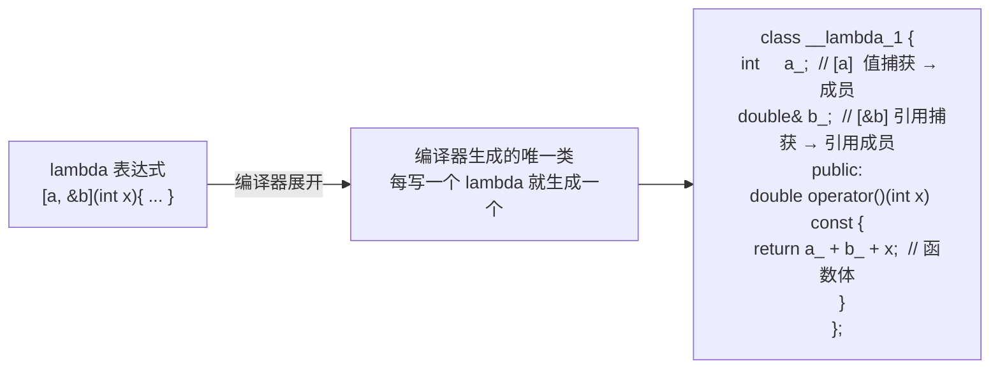

---
tags:
  - CPP/lambda
  - CPP/可变参数模板
  - CPP/核心
date: 2026-10-13
---

# lambda 与可变参数模板

承接 [[右值引用,移动语义,完美转发|右值引用、移动语义与完美转发]] 中的**万能引用 + 完美转发**，本篇回答两个问题：`lambda` 到底"是什么"（编译期被展开成了什么），以及**可变参数模板**如何把不定个数的参数打包后再展开，二者结合就得到线程池零开销的 `submit`。前者是"把函数当对象"，后者是"把不定个数的参数当数据"。

> [!important] 核心主线
> **lambda 的本质：编译器为每一个 lambda 表达式生成一个唯一的闭包类——捕获的变量成为成员，函数体成为 `operator()`。**
> **可变参数模板的本质：把不定个数的类型/参数打包成"参数包"，再用折叠表达式或包展开逐个使用。**
> 两者配合（万能引用 + 完美转发 + 广义捕获），可以在编译期绑定可调用对象与参数，实现零开销的任务提交。

---

## 一、lambda 的本质：编译器生成的闭包类



由此可以推出下面几条结论。

### 1.1 每个 lambda 都是独一无二的类型

```cpp
auto f1 = [](int x){ return x; };
auto f2 = [](int x){ return x; };
// 即便源码一模一样，也是两个不同的类，f1 与 f2 类型不同
```

### 1.2 闭包的大小 = 捕获成员的大小总和

```text
sizeof(无捕获)            = 1     ← 空类也要占 1 字节
sizeof([a] a 是 int)      = 4
sizeof([a, b] int + double) = 16  ← 4 + 8，再加 4 字节填充对齐
sizeof([&a] 捕获引用)      = 8     ← 引用本质是指针
```

> [!note] 成员顺序未指定
> 标准不规定捕获成员的声明顺序，因此 `int` + `double` 的具体填充位置由编译器决定；上面的结果在常见 64 位平台成立，但不应把它当成标准保证。

### 1.3 未被使用的捕获（仅限隐式捕获）

`[=]` / `[&]` 这类**隐式捕获**只会捕获 lambda 体内**实际用到**的变量；而显式写出的 `[x]` 无论是否用到，都会生成对应成员。

### 1.4 无捕获 lambda 可隐式转换为函数指针

无捕获的 lambda 拥有一个到函数指针的转换运算符，因此可以传给 C 风格回调；一旦有捕获就不能这样转换。

### 1.5 `operator()` 默认为 `const`

```cpp
auto f = [a]() { /* a = 5; */ };   // ✗ 编译错误：不能在 const 函数里改成员
```

需要修改按值捕获的**内部副本**时，用 `mutable` 去掉 `operator()` 的 `const`（修改的只是闭包自己的副本，不是外部对象）。若闭包会被多线程共享，`mutable` 下对这些成员的读写需自行加同步。

```cpp
auto f = [a]() mutable { a = 5; };   // ✓ 改的是闭包内部副本，外部 a 不变
```

---

## 二、捕获方式

| 写法 | 含义 |
| --- | --- |
| `[]` | 不捕获 |
| `[=]` | 按值捕获**用到的**外部变量 |
| `[&]` | 按引用捕获**用到的**外部变量 |
| `[x]` | 按值捕获 `x` |
| `[&x]` | 按引用捕获 `x` |
| `[this]` | 捕获 `this` 指针，访问类对象成员 |
| `[*this]` | 捕获 `*this` 的副本，拷贝整个对象（C++17） |
| `[x = expr]` | 广义捕获（init-capture），`x` 的类型由 `expr` 推导（C++14） |
| `[p = std::move(p)]` | 移动捕获，用广义捕获把对象移进闭包（C++14） |

> [!important] `this` 与 `*this` 的区别
> ```cpp
> struct Widget {
>     int value = 10;
>     auto by_this() { return [this]{ return value; }; }   // 捕获指针，大小 8
>     auto by_copy() { return [*this]{ return value; }; }   // 捕获副本，大小 4
> };
> ```
> `by_this` 闭包大小为 8，就是存了一个 `this` 指针；`by_copy` 闭包大小为 4，存了整个对象的副本。
> 关键区别：`[this]` 捕获指针，**必须保证对象的生命周期**；`[*this]` 捕获副本，**不依赖原对象存活**，更安全（但会拷贝整个对象）。
> 自 C++20 起，干脆对显式 `[this]` / `[*this]` 更友好，因为下面这条已被弃用。

> [!warning] `[=]` 在成员函数中的陷阱：捕获的是 `this` 指针
> 成员函数里写 `[=]`，**不是**捕获成员变量的副本，而是**隐式捕获 `this` 指针**（对类成员的访问都是通过 `this`）。
> ```cpp
> struct Detector {
>     std::string model_;
>     auto make_task() {
>         return [=]{ use(model_); };   // ✗ 实际是 [this]，捕获指针！
>     }
> };
> ```
> 自 **C++20（P0409R2）起，`[=]` 隐式捕获 `this` 已被弃用**；应显式写出 `[this]` 或 `[*this]`，让意图更清楚。

---

## 三、四个经典陷阱

### 3.1 引用捕获 + 异步执行 = 悬空

```cpp
std::string msg = "Hello";
threads.emplace_back([&msg]{ std::cout << msg; }); // 危险：多线程/异步下很可能悬空
```

安全写法是按值捕获（把数据拷进闭包）：

```cpp
threads.emplace_back([msg]{ std::cout << msg; }); // 按值捕获
```

### 3.2 对"引用变量"按值捕获，拷的是被引用对象

这是一个常见误解：`[ref]` 并不会拷贝"引用本身"，而是拷贝**引用所指向的对象**。

```cpp
std::string  msg = "Hello";
std::string& ref = msg;

auto f1 = [ref]{ std::cout << ref; };   // ✓ 拷贝的是 msg 本身（等价 [msg]）
auto f2 = [&ref]{ std::cout << ref; };  // 捕获的是 msg 的引用（等价 [&msg]）
```

> [!note] 规则
> 对一个引用实体按值捕获时，闭包成员的类型是**被引用的类型**（`std::string&` → `std::string`），并用该引用初始化，因此得到的是被引用对象的副本。想共享原对象，必须用引用捕获 `[&ref]`。

### 3.3 结构化绑定不能被捕获（C++17）

```cpp
auto [x, y] = get_point();
auto f = [x, y]{ return x + y; };   // ✗ C++17 编译错误：结构化绑定不是"变量"
// 直到 C++20（P1091）才允许捕获结构化绑定
```

### 3.4 循环变量的捕获

```cpp
for (const auto& item : items) {
    fs.push_back([&item]{ use(item); });   // ✗ 悬空
}
```

> [!warning] 为什么错
> range-for 每次迭代都会**新建**一个局部变量 `item`，它在**本轮迭代结束时销毁**。按引用捕获后，闭包保存的是对已销毁变量的引用，任务执行时即悬空。
> 修复：按值捕获 `[item]`（拷贝元素），或把需要的值单独存起来再捕获。

---

## 四、泛型 lambda

参数写成 `auto`，等价于一个模板化的 `operator()`；同一个闭包能接受多种参数类型。

```cpp
auto add = [](auto a, auto b){ return a + b; };   // 注意：auto 在参数列表，不在捕获列表
add(1, 2);       // int
add(1.0, 2.0);   // double
```

C++20 起还可以写显式模板参数，从而在函数体内获取类型名：

```cpp
auto f = []<typename T>(T a, T b){ return a + b; };   // C++20
```

---

## 五、lambda 与 `std::function` 的对比

| 维度 | lambda（闭包） | `std::function` |
| --- | --- | --- |
| 大小 | 捕获变量之和（可为 1） | 固定大小（libstdc++ 下约 32 字节） |
| 调用开销 | **可完全内联，零开销** | **一次间接调用**（类型擦除），可能堆分配 |
| 类型 | 每个 lambda 独立类型 | 统一类型 |
| 能否存储 | 需要 `auto` / 模板参数承接 | ✓ 可放进容器、作成员 |
| 捕获大对象 | 直接在闭包内 | 可能**堆分配**（超过小对象缓冲，如 16 字节） |

> [!note] 工程结论
> "任务的可调用对象在编译期用模板绑定（零开销），只在返回给调用方时把结果擦除成 `std::future<Ret>`"——因为 `future` 的类型必须统一，这是必要的擦除点。
> 更进阶的做法是自研一个带**小对象优化（SBO）**的任务包装，避免 `std::function` 的堆分配（很多高性能线程池，如 `taskflow`，就是这么做的），可作为优化方向。

---

## 六、可变参数模板

```cpp
template <typename... Ts>   // Ts  是"类型参数包"
void f(Ts... args);         // args 是"函数参数包"
```

要点：

- 参数包必须放在参数列表最后（类型包可被推导出时除外）；
- `sizeof...(args)` 拿到参数个数；
- 参数包**不能下标访问**，必须展开使用。

```cpp
template <typename... Ts>
void count_test(Ts... vs) {
    std::cout << sizeof...(vs);   // 空包时输出 0
}
count_test();   // 合法：输出 0
```

### 6.1 展开方式

| 方式 | 说明 |
| --- | --- |
| 折叠表达式 | C++17，一行展开，最简洁（见下表） |
| 逗号表达式 / `initializer_list` | C++17 前常用：`(void)std::initializer_list<int>{ (f(args), 0)... };` |
| 递归展开 | 拆出第一个参数，递归处理剩下的包 |

### 6.2 折叠表达式（C++17）

| 形式 | 名字 | 展开成 |
| --- | --- | --- |
| `(... op vs)` | 一元左折叠 | `((v1 op v2) op v3) ...` |
| `(vs op ...)` | 一元右折叠 | `(v1 op (v2 op v3)) ...` |
| `(init op ... op vs)` | 二元左折叠 | `(((init op v1) op v2) ...)` |
| `(vs op ... op init)` | 二元右折叠 | `(v1 op (v2 op (... op init)))` |

> [!warning] 空包规则
> 一元折叠遇到**空包**时，只有 `&&`（得 `true`）、`||`（得 `false`）、`,`（得 `void()`）有默认值；其他运算符的一元折叠对空包是 **ill-formed**，必须改用**二元折叠**给初始值。

### 6.3 综合示例：线程池的 `submit`

```cpp
template <typename F, typename... Args>
auto submit(F&& f, Args&&... args)
    -> std::future<std::invoke_result_t<F, Args...>>
{
    using Ret = std::invoke_result_t<F, Args...>;

    std::packaged_task<Ret()> task(
        [f = std::forward<F>(f), ...a = std::forward<Args>(args)]() mutable -> Ret {
            return std::invoke(std::move(f), std::move(a)...);
        });

    auto fut = task.get_future();
    // ... 把 task 推入队列，由工作线程执行
    return fut;
}
```

| 写法 | 用到的特性 | 为什么必须这样 |
| --- | --- | --- |
| `template <typename F, typename... Args>` | 可变参数模板 | 任务的可调用对象 + 参数个数都不定 |
| `F&& f`, `Args&&... args` | **万能引用** | 左值/右值都能接，且保留值类别 |
| `-> std::future<std::invoke_result_t<F, Args...>>` | 尾置返回类型 + `invoke_result_t` | 返回类型依赖参数，前置写不出来 |
| `f = std::forward<F>(f)` | 完美转发 + 广义捕获 | 保住所捕获对象的值类别，避免多一次拷贝 |
| `...a = std::forward<Args>(args)` | **包展开的广义捕获（C++20）** | 把整个参数包逐个转发进闭包 |
| `mutable` | 去掉 `operator()` 的 `const` | 因为要 `std::move(a)...`，移动会改成员 |
| `std::invoke(...)` | C++17 | 统一处理函数指针、成员函数指针、仿函数、lambda |
| `packaged_task<Ret()>` | `packaged_task` + `future` | 把"任务 + 结果"绑在一起，异常也会存进 future |

> [!note] 版本提醒
> `...a = std::forward<Args>(args)` 这种"包展开的初始化捕获"是 **C++20** 才有的语法；C++17 及以前需要借助 `std::bind`、元组或手写辅助结构来达到同等效果。

---

## 七、核心总结

### 7.1 一句话主线

```text
lambda 本质   → 编译器生成一个唯一的闭包类；捕获 = 成员变量，函数体 = operator()
捕获方式      → 值捕获拷副本（安全）；引用捕获拷指针（危险）；[x=expr] 支持移动捕获
this 陷阱     → [=] 在成员函数里捕获的是 this 指针，不是成员副本 → 用 [*this] 或显式列出
mutable       → 去掉 operator() 的 const；只改闭包内部副本；多线程下需自己同步
泛型 lambda   → auto 参数 = 模板 operator()；C++20 可写显式模板参数拿类型名
lambda vs function → lambda 零开销可内联；function 类型统一但多一次间接调用
可变参数模板  → 参数包不能下标访问，必须展开；sizeof...(pack) 拿个数
折叠表达式    → C++17 一行展开；空包只有 && || , 有默认值，其余需二元形式给初始值
submit 精髓   → 万能引用 + 完美转发进闭包（forward）+ 执行时 move + std::invoke
```

### 7.2 速查表

| 问题                                | 答案                                               |     |                       |
| --------------------------------- | ------------------------------------------------ | --- | --------------------- |
| 两个写法完全相同的 lambda 是同一类型吗？          | 不是，每个 lambda 表达式都有唯一类型                           |     |                       |
| 无捕获 lambda 的大小？                   | 1 字节（空类）                                         |     |                       |
| 捕获一个 `int&` 引用变量时，闭包存了什么？         | 被引用对象的**副本**（`[ref]` 等价 `[x]`）；要共享原对象须写 `[&ref]` |     |                       |
| 成员函数里 `[=]` 捕获了什么？                | 隐式捕获 `this` 指针（C++20 起被弃用）                       |     |                       |
| `operator()` 默认是 `const` 吗？       | 是；要改按值捕获的副本需加 `mutable`                          |     |                       |
| 无捕获 lambda 能变函数指针吗？               | 能；有捕获则不能                                         |     |                       |
| C++17 能捕获结构化绑定吗？                  | 不能，C++20 起才行                                     |     |                       |
| `sizeof...(args)` 得到什么？           | 参数包中元素的个数                                        |     |                       |
| 空包能直接一元折叠吗？                       | 只有 `&&`/`                                        |     | `/`,` 可以，其余需用二元折叠给初始值 |
| `submit` 里为什么 lambda 要 `mutable`？ | 因为执行时要 `std::move(a)...`，移动会修改闭包成员               |     |                       |

### 7.3 易错点

- 泛型 lambda 的 `auto` 写在**参数列表**里（`[](auto a){...}`），不是捕获列表。
- 对引用变量按值捕获，拷贝的是**被引用对象**，不是"引用的拷贝"——别记反。
- `[=]` 在成员函数中捕获的是 `this` **指针**，不是成员副本；C++20 起该写法已弃用。
- 按引用捕获 + 异步/线程 = 悬空；range-for 里对循环变量按引用捕获尤其危险。
- 未被使用的**隐式**捕获不会被捕获，但**显式**捕获一定会产生成员。
- 折叠表达式对空包：只有 `&&`/`||`/`,` 有单位元，其余一元折叠是 ill-formed。
- `...a = std::forward<Args>(args)` 是 C++20 语法，别在 C++17 工程里直接用。

---

> [!tip] 延伸
> 相关学习记录见 [[C++深入/学习进度.md]]；万能引用、引用折叠与完美转发见 [[右值引用,移动语义,完美转发|右值引用、移动语义与完美转发]]；模板推导基础见 [[C++深入/C++模板/C++ 函数模板与类型推导|函数模板与类型推导]]；`submit` 所在的线程池实现见 [[C++深入/C++多线程/线程池.md|线程池]]。
