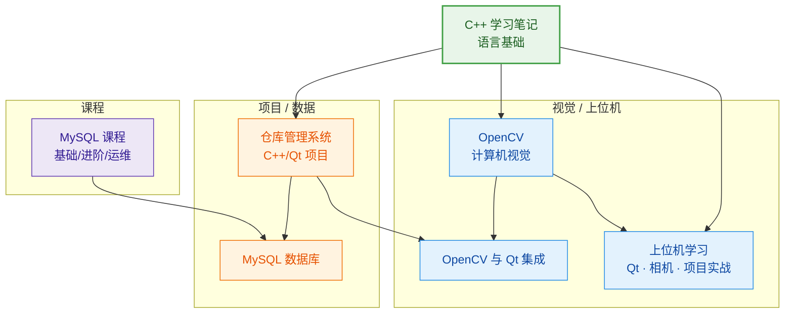

# 🧠 个人知识库总览

> 我的大学软件工程（C++ 方向）学习之旅，笔记主要用 **Obsidian** 记录。
> 本页是**所有知识库的入口**，从「语言基础」出发，串起「课程学习」与「项目实战」。

---

## 🗺️ 知识地图

> **核心关系**：
> - **C++** 是 [[视觉学习/OpenCV学习笔记/_MOC|OpenCV]]、[[仓库管理系统/_MOC|仓库管理系统]] 与 [[上位机学习/_MOC|上位机学习]] 的共同语言基础
> - **OpenCV 与 Qt 集成** 连接了视觉与桌面 UI 两大领域，也是 **上位机学习** 的技术底座
> - **上位机学习** 把「相机采集 / 通信协议 → Qt 原理 → 视觉项目实战」串成一条工程主线
> - 两套 **MySQL** 笔记互为「课程学习 ↔ 原理归纳」
> - **仓库管理系统** 是 C++/Qt/MySQL 的综合实战项目

---

## 📂 各知识库入口

| 领域 | 定位 | 入口 |
| --- | --- | --- |
| **C++** | 语言基础（语法 + 内存模型） | [[C++学习笔记/_MOC]] |
| **OpenCV** | 计算机视觉（课程 + 主题归纳） | [[视觉学习/OpenCV学习笔记/_MOC]] |
| **上位机学习** | 上位机开发（相机 SDK / 协议 / Qt 原理 / 项目实战） | [[上位机学习/_MOC]] |
| **仓库管理系统（WMS）** | C++17 / Qt 6 / MySQL 实战项目 | [[仓库管理系统/_MOC]] |
| **MySQL 课程** | 数据库学习路线（基础 / 进阶 / 运维） | [[MySQL数据库（lxj）/01 mysql课程介绍（导航栏）\|MySQL 课程]] |
| **MySQL 知识** | 数据库原理归纳（InnoDB / 索引 / 锁 / 优化） | [[MySQL数据库/MySQL数据库 MOC\|MySQL 知识 MOC]] |

---

## ✍️ 笔记模板

所有笔记模板统一放在根目录 **[[模板/_模板-通用笔记\|模板/]]** 文件夹，供 Obsidian「模板」核心插件调用：

| 模板 | 用途 |
| --- | --- |
| [[模板/_模板-通用笔记\|_模板-通用笔记]] | 通用主题笔记（推荐默认使用） |
| [[模板/_模板-主题笔记\|_模板-主题笔记]] | 按主题归纳散落知识点，便于复习复用 |
| [[模板/_模板-课程笔记\|_模板-课程笔记]] | 跟课逐课记录（如 OpenCV / YOLO 课程） |

> 各知识库的现有笔记已统一为同一套形式：**YAML frontmatter（title / type / 系列 / created / updated / tags / status）→ 一句话概述 → 编号小节 → 代码块与 callout → 相关笔记**。

---

## 🔄 跨领域关联（重点）

- **C++ ↔ OpenCV**：`cv::Mat`、`std::vector`、内存管理都建立在 C++ 基础之上
- **C++ ↔ 仓库管理系统**：指针、类、RAII、内存模型在 Qt 项目中大量应用
- **C++ ↔ 上位机学习**：相机 SDK、Qt 元对象系统、多线程取图都依赖 C++ 基础
- **OpenCV ↔ 上位机学习**：图像处理算法层与相机采集层分工配合（[[上位机学习/海康SDK/入门]]）
- **OpenCV ↔ 仓库管理系统**：BGR→RGB 转换、QImage 显示（见 [[OpenCV与Qt集成]]）
- **上位机学习 ↔ 视觉学习**：视觉标定、ONNXRuntime 推理服务于上位机视觉项目
- **MySQL 课程 ↔ MySQL 知识**：课程讲「怎么用」，知识库讲「为什么」（B+ 树、MVCC、锁）
- **仓库管理系统 ↔ MySQL**：项目持久层使用 MySQL，相关知识见 [[仓库管理系统/05_数据库知识/MySQL数据库基础知识汇总]]

---

*仓库主页，随学习进度持续更新。*
