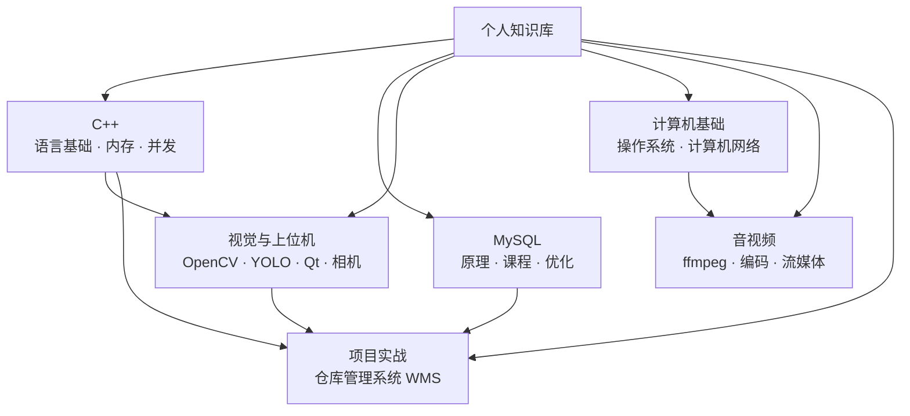

# 个人知识库总览

> 我的大学软件工程（C++ 方向）学习笔记入口，按 6 个主题组织：C++、MySQL、视觉与上位机、计算机基础、音视频、项目实战。

---

## 🗺️ 知识地图



> **核心关系**：
> - **C++** 是 [[视觉与上位机/_MOC|视觉与上位机]] 与 [[项目实战/_MOC|项目实战]] 的共同语言基础。
> - **MySQL** 同时支撑 [[项目实战/_MOC|仓库管理系统]] 的持久层与 [[MySQL/MySQL数据库/MySQL知识索引|原理归纳]]。
> - **计算机基础** 为音视频流媒体、网络通信与并发编程提供底层支撑。
> - **视觉与上位机** 把「相机采集 → 图像处理 → Qt 界面 → 模型推理」串成一条工程主线。

---

## 📂 六大主题入口

| 主题 | 定位 | 入口 |
| --- | --- | --- |
| **C++** | 语言基础（语法 + 内存模型 + 并发 + 新特性） | [[C++/_MOC\|C++ 知识库]] |
| **MySQL** | 数据库原理、SQL 课程与优化 | [[MySQL/_MOC\|MySQL 知识库]] |
| **视觉与上位机** | OpenCV / YOLO / Qt / 相机 SDK | [[视觉与上位机/_MOC\|视觉与上位机]] |
| **计算机基础** | 操作系统与计算机网络 | [[计算机基础/_MOC\|计算机基础]] |
| **音视频** | ffmpeg 概念、编码与流媒体 | [[音视频/_MOC\|音视频]] |
| **项目实战** | C++17 / Qt 6 / MySQL 仓库管理系统 | [[项目实战/_MOC\|项目实战]] |

---

## 🧭 目录结构

```text
笔记/
├── C++/
│   ├── _MOC.md
│   ├── 图片/
│   ├── 白板/_总览.canvas
│   ├── C++学习笔记/
│   └── C++深入/
├── MySQL/
│   ├── _MOC.md
│   ├── MySQL数据库/
│   └── MySQL课程/
├── 视觉与上位机/
│   ├── _MOC.md
│   ├── 视觉学习/
│   └── 上位机学习/
├── 计算机基础/
│   ├── _MOC.md
│   ├── 操作系统/
│   └── 计算机网络/
├── 音视频/
├── 项目实战/
├── 模板/
└── README.md
```

---

## ✍️ 笔记规范

- 每篇笔记包含 `title / type / topic / status / created / tags` 等 frontmatter 字段。
- 正文只有一个 H1，且与 `title` 完全一致；H1 后紧跟一行 `>` 概述。
- 图片统一放在各主题的 `图片/` 目录，引用时使用相对路径并填写 `alt`。
- 白板统一放在各主题的 `白板/` 目录，`_总览.canvas` 作为两级白板结构的入口。
- 笔记模板位于 [[模板/_模板-通用笔记\|模板/]]，包括课程笔记、主题笔记与通用笔记三套。

---

*仓库主页，随学习进度持续更新。*
