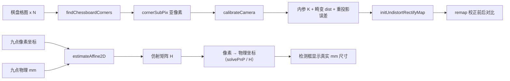
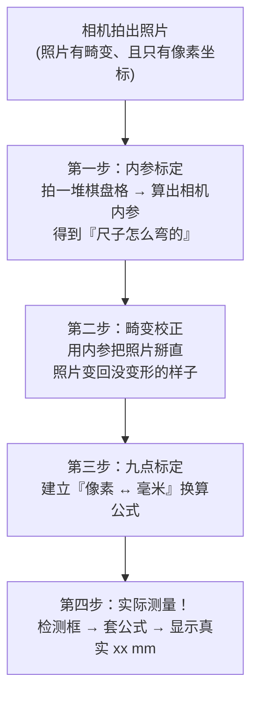

# 视觉标定

> 概述：视觉的本质是 **3D 世界 → 2D 像素的投影**，标定就是反过来求解这个投影关系里的未知参数。工程上把它拆成两层——**内参标定**（修相机自己）与 **手眼标定 / 九点标定**（连接相机和世界）。本页梳理两类标定的区别、针孔模型、张正友标定法、畸变模型、OpenCV 算子、精度评估，以及完整的标定流程。

---

## 一、标定是什么

一个形象的比喻：拿尺子去量东西，但你得先知道这把尺子到底有多歪、怎么歪，然后对每次量完的结果做一次「换算修正」，结果才准。相机标定就是让相机的输出能正常、准确地反映现实。

视觉的本质是 **3D 世界 → 2D 像素的投影**（降维，丢掉了深度）。标定就是反过来求这个投影关系中的未知参数，分为两层：

| 对比项 | 内参标定 | 手眼标定 |
|--------|----------|----------|
| **解决什么问题** | 相机的内部成像参数，如焦距、主点、畸变等 | 相机像素坐标与外部世界毫米坐标的对应关系 |
| **输入** | 一张张棋盘格图（标定的标准参照物） | 一组「像素点 ↔ 物理点」对应点对 |
| **输出** | 内参矩阵 K + 畸变系数 dist | 仿射 / 透视变换矩阵 H |
| **回答的问题** | 相机成像准不准 | 图上这条边在现实中是多少 mm？ |
| **不改硬件时** | 标一次，长期用 | 相机 / 工件 / 平台一动就要重新标 |

> **一句话记忆**：内参标定 = 修相机自己，手眼标定 = 连接相机和世界。

> [!内参里到底有哪些量]
> - **焦距 fx、fy**：镜头光学中心到成像平面的距离，在**内参矩阵中以像素为单位**（fx = f·sx，fy = f·sy）。它**不是「镜头的范围」**，而是决定成像放大倍率的量。
> - **主点 cx、cy**：光轴射到图像上的交点位置，理论上在图像正中央，实际存在偏差。
> - **畸变系数 (k1, k2, p1, p2, k3)**：描述镜头如何让图像发生畸变，k 为径向、p 为切向。

---

## 二、相机内参标定

### 1. 针孔相机模型

世界坐标点 $(X_w, Y_w, Z_w)$ 投影到像素坐标 $(u, v)$ 的完整关系（齐次坐标）：

$$
s\begin{bmatrix} u \\ v \\ 1 \end{bmatrix}
= \mathbf{K}\,[\,\mathbf{R}\mid\mathbf{t}\,]\,
\begin{bmatrix} X_w \\ Y_w \\ Z_w \\ 1 \end{bmatrix}
$$

其中 $s$ 为尺度因子（等于相机坐标系下的深度 $Z_c$），内参矩阵为：

$$
\mathbf{K}=
\begin{bmatrix}
f_x & 0 & c_x \\
0 & f_y & c_y \\
0 & 0 & 1
\end{bmatrix}
$$

- $f_x, f_y$：**像素单位**的焦距（$f_x = f\cdot s_x$，$f_y = f\cdot s_y$）
- $c_x, c_y$：主点坐标（像素）
- $\mathbf{R}$：$3\times3$ 旋转矩阵，$\mathbf{t}$：$3\times1$ 平移向量，二者合称**外参**

把矩阵乘开，就是最直观的形式——先由外参把世界点搬到相机坐标系，再用内参投影：

$$
\begin{bmatrix} X_c \\ Y_c \\ Z_c \end{bmatrix}
= \mathbf{R}\begin{bmatrix} X_w \\ Y_w \\ Z_w \end{bmatrix} + \mathbf{t},
\qquad
u = f_x\frac{X_c}{Z_c} + c_x,
\quad
v = f_y\frac{Y_c}{Z_c} + c_y
$$

> **注意**：$Z_c$ 是分母，深度信息在这一步被"除掉了"——这正是 2D 图像丢失深度的数学来源，也是为什么单张图无法直接还原 $Z$。

整个投影链涉及四个坐标系，理解这条链是理解标定的前提：

```
世界坐标系 ──[R, t 外参]──► 相机坐标系 ──[K 内参投影]──► 像素坐标系
   (X,Y,Z mm)              (Xc,Yc,Zc)                  (u,v 像素)
```

### 2. 张正友标定法

**原理**：使用已知格子间距的**平面棋盘格**，从多个不同角度拍摄，利用「同一棋盘在不同视角下，格子物理尺寸不变」这一约束解出内参。这是介于传统标定和自标定之间的一种方法，只需一块打印的棋盘格，精度却很高，是 OpenCV `calibrateCamera` 背后的算法。

**流程**：

1. 棋盘格角点在世界坐标中已知（令标定板平面 $Z_w = 0$，格子间距一致，例如 25 mm）。
2. 每张图检测出角点的像素坐标。
3. 用**单应性矩阵 $\mathbf{H}$** 把世界坐标与像素坐标联系起来，联立多张图，解出内参初值（$\mathbf{H}$ 有 8 个自由度）。
4. 考虑畸变，用**非线性最小二乘**优化，最小化重投影误差，得到最终内参。

因为标定板是平面，令 $Z_w = 0$ 后，投影式退化成一个二维单应关系：

$$
s\begin{bmatrix} u \\ v \\ 1 \end{bmatrix}
= \mathbf{K}\,[\,\mathbf{r}_1\ \ \mathbf{r}_2\ \ \mathbf{t}\,]
\begin{bmatrix} X_w \\ Y_w \\ 1 \end{bmatrix}
= \mathbf{H}\begin{bmatrix} X_w \\ Y_w \\ 1 \end{bmatrix},
\qquad \mathbf{H} = \mathbf{K}\,[\,\mathbf{r}_1\ \ \mathbf{r}_2\ \ \mathbf{t}\,]
$$

每张图求出各自的 $\mathbf{H}$，再用「$\mathbf{r}_1, \mathbf{r}_2$ 正交（对应旋转矩阵约束）」列方程联立，即可解出 $\mathbf{K}$ 的初值。

> [!标定板的常见类型]
> - **棋盘格（Checkerboard）**：最经典，`findChessboardCorners` 直接支持。
> - **圆点 / 圆环标定板**：圆心定位抗镜头畸变更强，适合大畸变镜头。
> - **ChArUco**：棋盘格 + ArUco 码，兼顾角点精度与遮挡鲁棒性，部分被遮挡也能用。
> - **AprilTag / ArUco**：适合位姿估计，常用于手眼标定与实时跟踪。

### 3. 畸变模型（径向 + 切向）

畸变就是原本的直线被弯曲了。

- **径向畸变**（镜头曲率导致，最主导）——直线变弯，由 $k_1, k_2, k_3$ 描述。
- **切向畸变**（镜头与传感器不平行导致）——由 $p_1, p_2$ 描述。

在归一化平面坐标 $(x, y) = (X_c/Z_c,\ Y_c/Z_c)$ 上，畸变模型为：

$$
\begin{aligned}
x_{dist} &= x\,(1 + k_1 r^2 + k_2 r^4 + k_3 r^6) + 2p_1 xy + p_2(r^2 + 2x^2) \\[4pt]
y_{dist} &= y\,(1 + k_1 r^2 + k_2 r^4 + k_3 r^6) + p_1(r^2 + 2y^2) + 2p_2 xy
\end{aligned}
\qquad (r^2 = x^2 + y^2)
$$

前一项 $1 + k_1r^2 + k_2r^4 + k_3r^6$ 是**径向**部分，后两项是**切向**部分。最后再乘内参得到像素坐标：

$$
u = f_x\,x_{dist} + c_x, \qquad v = f_y\,y_{dist} + c_y
$$

常见畸变类型：

```
桶形畸变（往外凸）          枕形畸变（往里凹）
   ┌───────┐                ┌───────┐
   │(     )│                │\     /│
   │ (   ) │                │ )   ( │
   │(     )│                │/     \│
   └───────┘                └───────┘
   边线向外鼓                边线向内陷
```

广角镜头常见**桶形畸变**，长焦镜头常见**枕形畸变**。畸变系数顺序为 `(k1, k2, p1, p2, k3)`。

### 4. 相关算子（OpenCV）

| 算子                                      | 作用                              |
| --------------------------------------- | ------------------------------- |
| `findChessboardCorners`                 | 粗定位棋盘格角点（像素级）                   |
| `cornerSubPix`                          | 亚像素精化角点，直接影响精度                  |
| `calibrateCamera`                       | 主函数，输入多张图的角点，输出 K、dist、外参、重投影误差 |
| `solvePnP`                              | 已知内参 + 3D-2D 对应点，解外参（位姿）        |
| `undistort` / `initUndistortRectifyMap` | 畸变矫正                            |

### 5. 重投影误差

**定义**：把解出来的参数（K、dist、外参）重新投影回图像，与**实际检测到的角点**计算像素距离，取所有点、所有图的平均值。

设第 $i$ 个角点实际检测到的是 $\mathbf{p}_i$，用参数投影回去得到 $\hat{\mathbf{p}}_i$，则重投影误差为：

$$
E = \sqrt{\frac{1}{N}\sum_{i=1}^{N}\left\|\,\mathbf{p}_i - \hat{\mathbf{p}}_i\,\right\|_2^2}
$$

标定的优化目标就是让 $E$ 最小（OpenCV 的 `calibrateCamera` 返回的 `ret` 即此值）。

**多少算合格**：

- **< 0.5 像素** 优秀
- **0.5 ~ 1.0 像素** 可接受
- **> 1.0 像素** 需要检查：棋盘不平、图太少、角点没提准、拍摄姿态太单一

本质上它就是模型的**拟合残差**，小说明这套参数能很好地解释观测数据。

### 6. 畸变矫正

| 方式 | 说明 | 特点 |
|------|------|------|
| `undistort(src, dst, K, dist)` | 一步到位 | 每帧重算，慢 |
| `initUndistortRectifyMap()` + `remap()` | 预计算映射表，之后每帧只查表 | **工业实时场景常用** |

---

## 三、手眼标定 / 九点标定（像素 → mm）

相机图像的像素坐标与真实世界的毫米坐标之间的换算关系。

> [!概念澄清：手眼标定 ≠ 九点标定]
> - **严格意义上的手眼标定**：求**相机与机械手之间的位姿关系**，即求解 `AX = XB`，用于把图像目标坐标交给机械手去抓。
>   - **Eye-in-Hand（眼在手）**：相机装在机械手末端，随手臂运动，标定相机与末端的关系。
>   - **Eye-to-Hand（眼固定）**：相机固定，俯视整个工作区，标定相机与机械基座的关系。
> - **九点标定**：本质是**平面内的 2D 映射**（像素平面 → 工作平面 mm），是机器视觉里最常用的简化标定。
> - 很多上位机教材把「像素 → 机器人坐标」的平面映射也叫手眼标定，属于**口语化用法**；严格区分时应按上面的定义理解。

### 1. 九点标定

**做法**：在一块标定板上选取 **9 个以上的点**，记录它们的：

- **图像中的像素坐标**（`findChessboardCorners` 自动提取，或手动点选）
- **现实中的物理坐标**（用游标卡尺量，或用标定板出厂标注的点位坐标，单位 mm）

然后用这些点对求变换矩阵（换算关系）：

| 变换 | 参数个数 | OpenCV 算子 | 适用条件 |
|------|----------|-------------|----------|
| **仿射变换** | 6 参数 | `estimateAffine2D` | 平移、旋转、缩放、错切；要求相机光轴垂直于标定平面（正拍） |
| **透视变换** | 8 参数 | `findHomography` / `getPerspectiveTransform` | 允许「近大远小」，用于相机有倾角的情况 |

> **理解**：仿射是透视在「平面与像面平行」时的特例；只要标定平面与像面不平行，就必须用透视变换（单应性矩阵 H，3×3，尺度无关，实际 8 自由度）。

**误差量级**：

- 工业相机 + 远心镜头 + 好的标定板：可达 **0.05 mm**
- 普通 USB 相机 + 打印棋盘格：**0.1 ~ 0.5 mm**

**精度关系**（近似）：

$$
\text{测量精度} \approx \text{重投影残差}(\text{像素}) \times \text{单像素物理尺寸}(\text{mm/pixel})
$$

> **远心镜头为什么准**：普通镜头有透视，物体远近会让尺寸变化；远心镜头只有平行光进入，几乎消除透视误差，测量尺寸只与像素数有关，所以工业测量首选远心镜头。

### 2. 用变换矩阵还原真实世界坐标（像素 → mm）

九点标定的最终产物就是一个变换矩阵。实际测量时，把检测框的像素坐标代进去即可得到毫米坐标。

**① 仿射变换（6 参数）**

`estimateAffine2D(pixelPts, mmPts)` 返回 $2\times3$ 仿射矩阵，映射关系（像素 → mm）为：

$$
\begin{bmatrix} X \\ Y \end{bmatrix}
= \begin{bmatrix} m_{00} & m_{01} \\ m_{10} & m_{11} \end{bmatrix}
\begin{bmatrix} u \\ v \end{bmatrix}
+ \begin{bmatrix} m_{02} \\ m_{12} \end{bmatrix}
$$

写成齐次形式：

$$
\begin{bmatrix} X \\ Y \\ 1 \end{bmatrix}
= \mathbf{M}\begin{bmatrix} u \\ v \\ 1 \end{bmatrix},
\qquad
\mathbf{M} = \begin{bmatrix} m_{00} & m_{01} & m_{02} \\ m_{10} & m_{11} & m_{12} \\ 0 & 0 & 1 \end{bmatrix}
$$

**② 透视变换 / 单应性（8 参数）**

`findHomography(pixelPts, mmPts)` 返回 $3\times3$ 的 $\mathbf{H}$（映射像素 → mm）：

$$
s\begin{bmatrix} X \\ Y \\ 1 \end{bmatrix}
= \mathbf{H}\begin{bmatrix} u \\ v \\ 1 \end{bmatrix},
\qquad
\mathbf{H} =
\begin{bmatrix} h_{11} & h_{12} & h_{13} \\ h_{21} & h_{22} & h_{23} \\ h_{31} & h_{32} & h_{33} \end{bmatrix}
$$

展开并两边同除以第三行、消去尺度因子 $s$，就得到**最终的真实世界坐标公式**：

$$
X = \frac{h_{11}u + h_{12}v + h_{13}}{h_{31}u + h_{32}v + h_{33}},
\qquad
Y = \frac{h_{21}u + h_{22}v + h_{23}}{h_{31}u + h_{32}v + h_{33}}
$$

代码实现：

```python
import numpy as np
import cv2

# pts_pixel: N×2 像素坐标; pts_mm: N×2 物理坐标(mm)
H, _ = cv2.findHomography(pts_pixel, pts_mm)   # H: 像素 → mm

def pixel_to_mm(u, v, H):
    p = H @ np.array([u, v, 1.0])
    return p[0] / p[2], p[1] / p[2]            # 除以齐次分量得到真实坐标
```

> [!注意方向]
> `findHomography(A, B)` 得到的是把 **A 映射到 B** 的 $\mathbf{H}$。要算「像素 → mm」就必须传 `(pts_pixel, pts_mm)`；如果传反了，得到的是「mm → 像素」的矩阵，需要求逆 $\mathbf{H}^{-1}$ 或直接反过来使用。

**③ 求解原理（为什么至少 4 个点）**

$\mathbf{H}$ 尺度无关，实际只有 8 个未知量，每个点对提供 2 个方程，故**至少 4 组点对**（工程上多用几个点做最小二乘更稳）。求解用 **DLT（直接线性变换）**，写成 $A\mathbf{h}=\mathbf{0}$，取 $A$ 最小奇异值对应的右奇异向量：

$$
\mathbf{h} = \arg\min_{\|\mathbf{h}\|=1}\|A\mathbf{h}\|_2^2
$$

仿射同理，只是未知量从 8 个降到 6 个，可用最小二乘闭式解：

$$
\mathbf{M} = \arg\min_{\mathbf{M}} \sum_i
\left\|
\mathbf{M}\begin{bmatrix} u_i \\ v_i \\ 1 \end{bmatrix}
- \begin{bmatrix} X_i \\ Y_i \\ 1 \end{bmatrix}
\right\|_2^2
$$

**④ 三维情形：真·手眼标定的变换**

若相机与机械手之间是完整的三维位姿关系（如 Eye-in-Hand），标定结果是 $4\times4$ 齐次变换矩阵 $\mathbf{T}_{cam\to robot}$，把相机坐标系下的点搬成机械手 / 世界坐标：

$$
\begin{bmatrix} X_{w} \\ Y_{w} \\ Z_{w} \\ 1 \end{bmatrix}
= \mathbf{T}_{cam\to robot}\begin{bmatrix} X_c \\ Y_c \\ Z_c \\ 1 \end{bmatrix},
\qquad
\mathbf{T} = \begin{bmatrix} \mathbf{R} & \mathbf{t} \\ \mathbf{0} & 1 \end{bmatrix}
$$

平面测量场景下，工件高度固定、$Z_c$ 已知，上式就退化回前面 2D 的仿射 / 透视映射。

---

## 四、完整标定流程

### 流程图 A：从棋盘格到实时测量



### 流程图 B：标定的四步主线



### 流程总结

1. **内参标定** —— 搞清楚相机本身的问题
2. **畸变校正** —— 校正相机本身的问题
3. **手眼 / 九点标定** —— 建立相机坐标与真实坐标的关系
4. **得到最终准确的测量结果**，例如照片里直线的长度对应现实中的长度

---

## 五、误差来源与注意事项

| 误差来源 | 说明与对策 |
|----------|-----------|
| **标定板不平 / 打印精度差** | 用高精度陶瓷/玻璃标定板；棋盘格必须平贴、无翘曲 |
| **角点提取不准** | 必须做 `cornerSubPix` 亚像素；保证棋盘成像清晰、对比度高 |
| **姿态太单一** | 拍摄时倾斜、旋转、远近都要覆盖，至少 10~20 张 |
| **只标一次就长期用** | 相机、镜头、工件、平台任何一方移动后都要**重新标定** |
| **镜头选型不当** | 有透视需求用小孔/远心镜头；测尺寸优先远心镜头 |
| **物理坐标测量误差** | 九点标定中物理点用卡尺量，本身误差会直接传入标定结果 |

---

## 六、面试必问

> [!面试必问]
> **1. 内参标定解决的是什么问题？**
> 求相机内部成像参数（焦距、主点、畸变等），用于修正镜头带来的畸变，让像素坐标能够正确地反映成像几何关系。
>
> **2. 手眼标定解决什么问题？**
> 求相机坐标系与世界 / 机械坐标系之间的对应关系，将图像像素坐标换算成物理坐标（mm），这样测出来的尺寸才有意义。
>
> **3. 内参标定和手眼标定的输入输出分别是什么？**
> 内参：输入多张棋盘格图，输出 K + dist；手眼：输入一组像素 ↔ 物理点对，输出变换矩阵 H。
>
> **4. 为什么需要畸变矫正？**
> 镜头让直线弯曲，测出来的尺寸会失真。用内参把图像「掰直」后，像素与世界才是线性可换算的。
>
> **5. 重投影误差多大算合格？**
> < 0.5 像素优秀，0.5~1.0 可接受，> 1.0 需排查标定板平整度、图片数量与角点质量。
