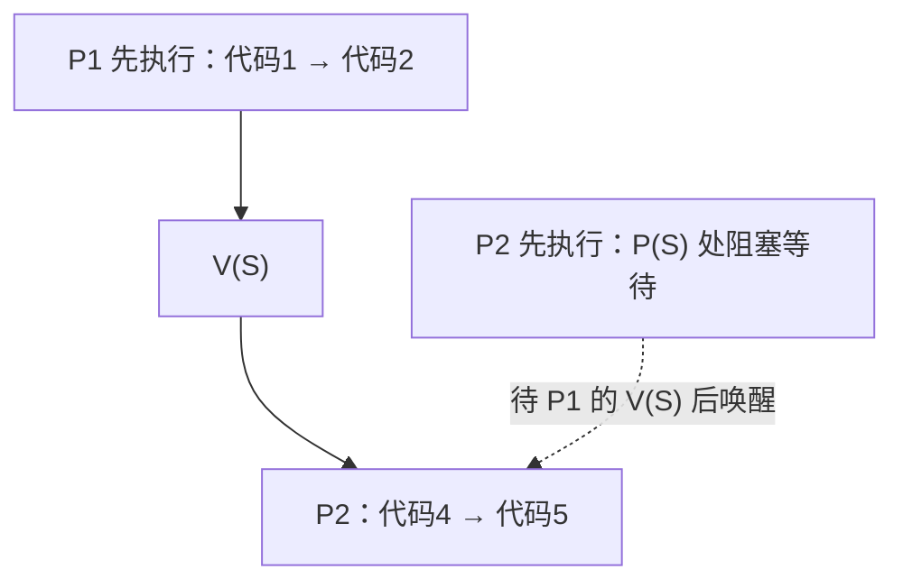
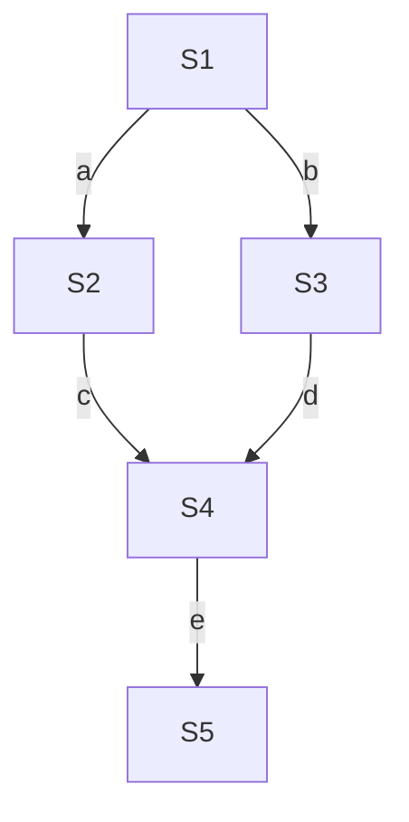

# 信号量机制

> 概述：信号量机制用于实现**进程 / 线程的互斥与同步**。本篇梳理 **信号量是什么（P / V 原语）→ 整型 vs 记录型信号量 → 用信号量实现互斥 → 实现同步（前 V 后 P）→ 实现前驱关系** 这条主线。

---

## 一、信号量是什么

- 信号量用于实现**进程互斥 / 线程互斥**，由操作系统中的**原语**实现。
- **原语**：`wait(S)`（又称 `P(S)`、**P 操作**）、`signal(S)`（又称 `V(S)`、**V 操作**）。
- 核心思想：把「**检查 + 上锁**」封装成一个**原子操作（原语）**，从而避免并发导致的问题。

| 操作 | 别名 | 作用 |
| --- | --- | --- |
| `wait(S)` | P(S)、P 操作 | **申请资源**（先检查、再占用） |
| `signal(S)` | V(S)、V 操作 | **释放资源** |

---

## 二、两类信号量

### 1. 整型信号量

- 用一个**整型变量**表示信号量。

```c
void wait(int S){        // P 操作
    while (S <= 0);      // 资源不够 → 一直空转
    S = S - 1;           // 资源够 → 占用一个
}
void signal(int S){      // V 操作
    S = S + 1;           // 释放一个资源
}
```

- 缺点：**不满足「让权等待」**——资源不够时进程会一直 **忙等（空转）**，**占用处理机**。
- **让权等待**：进程暂时无法继续执行时，应**主动让出处理机**，而不是占着 CPU 空转。

### 2. 记录型信号量

- 用「**整型 value + 等待进程队列 L**」表示信号量，解决了忙等问题。

```c
typedef struct {
    int value;          // 剩余资源数；< 0 时 |value| 为等待进程数
    struct process *L;  // 等待该资源的进程队列
} semaphore;

void wait(semaphore S){      // P 操作：申请资源
    S.value--;
    if (S.value < 0) {
        block(S.L);          // 资源不足 → 阻塞自己：运行态 → 阻塞态，让出 CPU
    }
}
void signal(semaphore S){    // V 操作：释放资源
    S.value++;
    if (S.value <= 0) {
        wakeup(S.L);         // 仍有进程在等 → 唤醒队首进程：阻塞态 → 就绪态
    }
}
```

- **`value` 的语义**：`value > 0` 表示**剩余可用资源数**；`value < 0` 时其绝对值 `|value|` 表示**正在等待的进程数**。
- **阻塞原语 `block`**：等待进程自我阻塞，**运行态 → 阻塞态**，让出 CPU，**不会忙等**。
- **唤醒原语 `wakeup`**：唤醒等待队列中的**第一个（队首）进程**，**阻塞态 → 就绪态**。

> [!warning] 易错点
> 被唤醒的进程是「阻塞态 → **就绪态**」，**不是**直接到运行态；要等调度程序再次选中它才会运行。

### 3. 两者对比

| 对比项 | 整型信号量 | 记录型信号量 |
| --- | --- | --- |
| 表示方式 | 一个整型变量 | 整型 value + 等待队列 |
| 资源不足时 | **忙等**（占用处理机空转） | **阻塞**，让出处理机 |
| 是否满足让权等待 | ❌ 不满足 | ✅ 满足 |

---

## 三、用信号量实现进程互斥

- 设互斥信号量 `mutex`，**初值为 1**（临界资源只有 1 份）。
- **临界区前 P、临界区后 V**：

```c
semaphore mutex = 1;

void P(){
    ...
    P(mutex);       // 申请资源（进入区）
    // 临界区代码
    V(mutex);       // 释放资源（退出区）
    ...
}
```

- ==🔴P、V 操作必须成对出现==，且**同一信号量的 P / V 要配对**。

---

## 四、用信号量实现进程同步

- 同步：让两个进程按**约定的先后顺序**执行。
- 口诀：***前 V 后 P***——**先执行的代码后面 V，后执行的代码前面 P**。
- 同步信号量初值一般为 **0**。

```c
P1(){
    代码1
    代码2
    V(S)        // 代码2 之后 V：通知「我已执行到代码2」
    代码3
}
P2(){
    P(S)        // 代码4 之前 P：等待「代码2 已完成」
    代码4
    代码5
}
```

- 若 **P2 先执行**：P2 卡在 `P(S)` 处等待，直到 P1 执行完代码2 并 `V(S)` 后才继续 → 保证**代码4 在代码2 之后**。
- 若 **P1 先执行**：P1 执行完代码2 后 `V(S)`，P2 的 `P(S)` 不会阻塞，直接执行代码4 → 同样保证顺序。



---

## 五、用信号量实现前驱关系

- 前驱关系（A 必须在 B 之前）本质是一组**同步**问题。
- 为**每一条有向边**设一个信号量，**初值为 0**；**前驱节点后 V，后继节点前 P**。



> 例如边 `S2 → S4`：在 `S2` 结束后 `V(c)`，在 `S4` 开始前 `P(c)`。有几条前驱边就设几个信号量。

![[Pasted image 20261015202341.png]]

---

## 六、易错点 / 注意事项

- ==🔴P、V 必须成对、且同一信号量配对==；缺 P 会失去互斥，缺 V 会死锁。
- **整型信号量**不满足让权等待、会**忙等**；**记录型信号量**才满足。
- **唤醒 ≠ 立即运行**：`wakeup` 使进程 **阻塞态 → 就绪态**，需再被调度才到运行态。
- `value < 0` 时，`|value|` = **等待进程数**；`value > 0` 时 = **剩余资源数**。
- **互斥用 mutex 初值 1**（临界区前 P 后 V）；**同步用信号量初值 0**（前 V 后 P）。

---

## 七、小结

- 信号量用 **P / V 原语**实现互斥与同步，核心是**把检查与上锁封装为原子操作**。
- **整型信号量**会忙等；**记录型信号量**靠 `block` / `wakeup` 满足**让权等待**。
- 三大用法：**互斥**（mutex 初值 1，前 P 后 V）、**同步**（初值 0，前 V 后 P）、**前驱关系**（每条边一个初值 0 的信号量）。

---

## 相关笔记

- [[README]] —— 仓库主页 / 知识库总览
- [[进程]] —— 进程同步、进程互斥与临界区
- [[调度]] —— 临界区、内核程序临界区与调度时机
- [[系统调用]] —— 原语与系统调用
- 操作系统 `_MOC`（知识库总览）尚未创建，创建后在此链接

---

- **知识库总览**：[[README]]
- **仓库主页**：[[README]]
