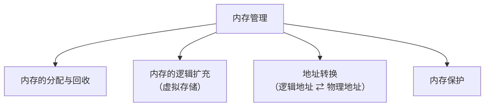
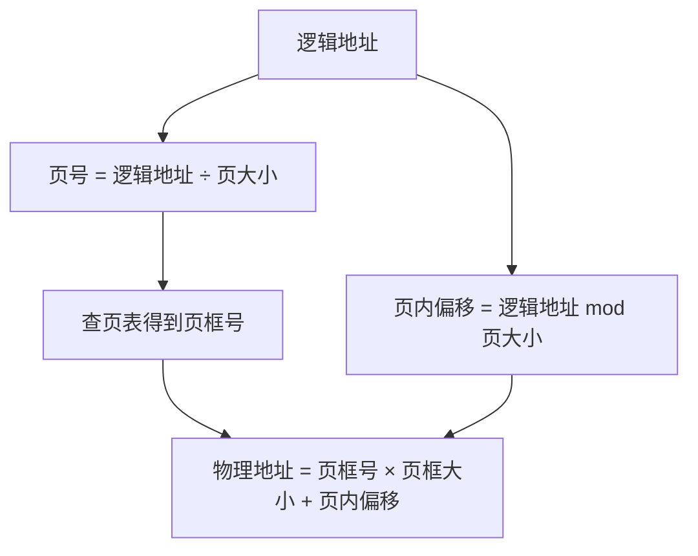
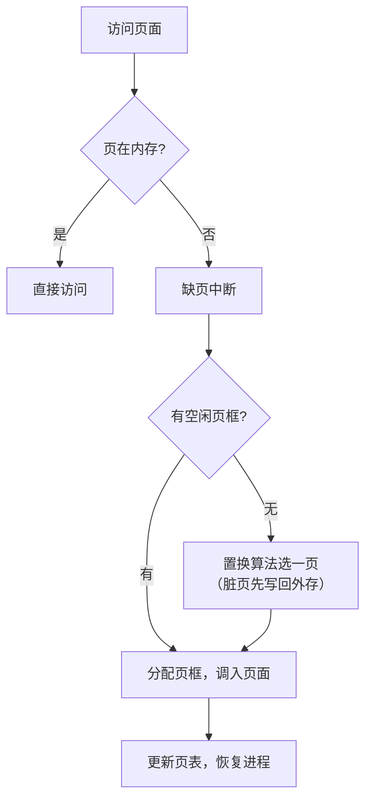

# 内存

> 概述：内存（运行内存）是操作系统的「工作台」，程序必须先装入内存才能被 CPU 处理。本篇梳理 **内存基础 → 内存管理做什么 → 连续分配 → 非连续分配（分页 / 分段 / 段页式）→ 快表与多级页表 → 虚拟内存 → 请求分页与页面置换 → 抖动与工作集** 这条主线。

---

## 一、内存与存储基础

- **内存（RAM，运行内存 / 主存）** 是操作系统的「工作台」，CPU 直接访问；**外存（硬盘 / 辅存）** 用于长期保存，不能被 CPU 直接处理。
- 程序执行前必须先**放到内存中**，才能被 CPU 处理。

### 1. 存储单元的组织方式

| 编址方式 | 每个存储单元大小 | 说明 |
| --- | --- | --- |
| 按**字节**编址 | 1 B（8 bit） | 最常见 |
| 按**字**编址 | 1 字（16 bit） | 字长由机器决定 |

### 2. 常见数量单位

| 单位 | 换算 |
| --- | --- |
| 1 B | 8 bit |
| 1 K | 2^10 |
| 1 M | 2^20 |
| 1 G | 2^30 |

> [!note] 举例：4 GB 内存
> 4 GB = 2^32 B，因此需要用 **32 个二进制位**才能表示完所有内存地址（地址位数 = log₂ 存储单元总数）。

### 3. 指令的工作原理

- 每条 CPU 指令都包含**操作码 + 操作数 / 内存地址**等信息。
- 程序经编译、链接后，指令中给出的是**逻辑地址（相对地址，相对于进程起始地址）**，而**不是物理地址（绝对地址）**。
- 把逻辑地址「翻译」成物理地址的过程叫**地址重定位**。

### 4. 装入内存的三种方式（地址重定位）

| 方式 | 别名 | 时机 | 特点 |
| --- | --- | --- | --- |
| **绝对装入** | — | 编译时 | 编译时直接产生绝对地址，只适用于单道程序环境 |
| **可重定位装入** | 静态重定位 | 装入时 | 装入时一次性把逻辑地址转换完；**要求一次分配全部所需内存空间**，装入后**不可移动** |
| **动态运行时装入** | 动态重定位 | 运行时 | 靠**重定位寄存器**在 CPU 执行时实时转换；**允许进程在内存中移动** |

### 5. 从程序到程序运行（链接）

```
程序源代码 --编译--> 目标模块（含各模块的逻辑地址）
         --链接--> 装入模块（完整的逻辑地址）
         --装入--> 进程
```

链接的三种方式：

1. **静态链接**：运行前把各目标模块拼成一个完整的装入模块。
2. **装入时动态链接**：装入内存时边装入、边链接。
3. **运行时动态链接**：执行中用到某个模块时才去链接（节省内存、便于更新）。

---

## 二、内存管理要做什么

内存管理负责四件事：



### 1. 内存保护

用于阻止进程访问**不属于自身**的内存地址，常见实现：

1. **上、下限寄存器**：检查访问是否越界。
2. **重定位寄存器 + 界地址寄存器**：重定位寄存器存放进程的**起始物理地址**，界地址寄存器存放**最大逻辑地址（即长度）**。

### 2. 进程的内存映像

- 32 位系统中，进程虚拟地址空间为 **4 GB**。
- 内存分为：**操作系统内核区、用户区、未使用区**。
- 具体分区映像：

![[Pasted image 20261015211837.png|436]]

---

## 三、连续分配管理方式

> 指为一个进程分配**一片连续**的内存空间，按出现顺序分三种。

### 1. 单一连续分配

- 内存分为**系统区 + 用户区**，用户区一次只能装入**一个**进程。
- 优点：简单、**无外部碎片**。
- 缺点：只支持单用户单任务；会产生**内部碎片**（用户区未被充分利用的部分）。

### 2. 固定分区分配

- 将用户区预先划分为**若干大小固定**的分区。

| 划分方式 | 适用场景 |
| --- | --- |
| 分区大小**相等** | 多个**相同**对象（如多台同型号设备）的场景 |
| 分区大小**不等** | 多个**不同**任务的场景 |

- 用一张**分区说明表**记录每个分区的**大小、起始地址、状态**。
- 优点：**无外部碎片**；缺点：会产生**内部碎片**，且程序过大时需借助覆盖技术。

### 3. ==🔴动态分区分配==

- 根据进程**实际大小**动态建立分区，是本节的**重点与考点**。
- 记录空闲内存的两种数据结构：**空闲分区表（数组）** / **空闲分区链（链表）**。

#### 动态分区分配算法

| 算法 | 空闲分区排列 | 分配规则 | 问题 |
| --- | --- | --- | --- |
| **首次适应** | 地址**递增** | 找到**第一个**满足要求的空闲分区 | — |
| **最佳适应** | 容量**递增** | 优先用**最小**的够用空闲区 | 易产生大量**外部碎片** |
| **最坏适应** | 容量**递减** | 优先用**最大**的空闲分区 | 大内存进程反而可能分配困难 |
| **临近适应** | 地址**递增** | 从**上次结束位置**起找第一个够用的 | 高地址大分区易被耗尽 |

![[Pasted image 20261015220614.png]]

#### 内部碎片 vs 外部碎片

| 类型 | 含义 |
| --- | --- |
| **内部碎片** | 分配给进程的**内存块内部**未被利用的部分 |
| **外部碎片** | 内存中**太小而难以利用的空闲分区**，可通过**紧凑（拼凑）**技术挪动分区、合并解决 |

动态分区分配的过程就是「按某种算法分配、回收，并把**相邻的空闲分区合并**」。

---

## 四、非连续分配管理：分页存储

> 允许一个进程占用**多个不连续**的内存块，从而减少（外部）碎片。

### 1. 基本概念

- 把**物理内存**划分为大小相等的**页框（页帧、内存块）**，每个页框有一个**页框号（块号）**，从 0 开始。
- 把**进程的逻辑地址空间**划分为与页框**等大**的**页（页面）**，每个页有一个**页号**，从 0 开始。
- **页框大小 = 页大小**。

### 2. 页表（慢表）

- **页表**：记录「进程的页」→「实际存放的内存块」的**映射关系**。
- 一个**页表项**由 **页号（隐含，相当于数组下标，不占空间）+ 页框号** 组成。

#### 每个页表项占多少字节？

```
物理内存大小为 4 GB，页大小为 4 KB，求每个页表项大小。
```

- 页大小 4 KB = 2^12 B；
- 页框数 = 2^32 B ÷ 2^12 B = 2^20；
- 需要 20 bit 表示页框号 → **最少 3 B**。

> [!warning] 易错点
> 3 B 只是「装得下页框号」的**最小值**。实际页表项还要存放**存在位、访问位、修改位、保护位**等标志，因此真实页表项通常取 **4 B**。

### 3. 地址转换

**逻辑地址 → 物理地址**：

```
页号       = 逻辑地址 ÷ 页大小   （整除）
页内偏移量 = 逻辑地址 mod 页大小
物理地址   = 页框号 × 页框大小 + 页内偏移量
```



### 4. 基本地址变换机构

- 设置一个**页表寄存器（PTR）**，存放页表的**起始地址**和**页表长度**。
- 进程**未执行**时，页表起始地址和页表长度存放在 **PCB** 中；进程**执行**时，操作系统把它们放入**页表寄存器**。

---

## 五、分页的硬件支持：快表与多级页表

### 1. 快表（TLB）

- **快表（TLB，联想寄存器 / 翻译后备缓冲）**：一种**高速缓存（SRAM）**，存放**最近访问过的若干个页表项副本**（页表本身存在内存 DRAM 中）。
- 作用：避免每次都查内存中的页表，**减少访存次数**。

**读一个数据的访存次数**：

| 情况 | 访存次数 |
| --- | --- |
| 无快表（基本地址变换） | **2 次**（查页表 1 次 + 取数据 1 次） |
| 有快表且**命中** | **1 次**（只需取数据，查快表不访存） |
| 有快表但**未命中** | **2 次**（查内存页表 1 次 + 取数据 1 次） |

> [!note] 快表未命中时，查到页表项后要**把它放入快表**（快表满则按算法淘汰一项）。

### 2. 多级页表

- **问题**：32 位系统、页大小 4 KB、页表项 4 B → 页表有 2^20 项、占 **4 MB**，且要求**连续存放**，代价大。
- **解决**：把**页表本身再分页**，形成「**一级页号 + 二级页号**」的**两级页表**。顶级页表称**页目录表**。
- **优点**：不必让所有页表都常驻内存，**用到哪部分才调入哪部分**。

**两级页表的地址结构**：

```
| 一级页号 | 二级页号 | 页内偏移量 |
```

转换：一级页号查**页目录** → 二级页表的页框号；二级页号查**二级页表** → 物理页框号；再拼**页内偏移**。

---

## 六、分段存储与段页式

### 1. 分段存储

- 按程序的**逻辑结构（模块）**划分：如主程序段、子程序段、数据段、栈段等。
- 每段**从 0 开始编址**，各段**长度不同**。
- **逻辑地址 = 段号 + 段内偏移量**（**二维**）。
- **段表**：段号 → **段长 + 基址**。

**地址变换**：

1. 用段号查段表，得到该段的**基址**与**段长**；
2. **合法性检查**：若 `段内偏移量 ≥ 段长` → **越界中断**；
3. **物理地址 = 段基址 + 段内偏移量**。

### 2. 段页式

- 先按**逻辑结构分段**，段内再**分页**。
- **逻辑地址 = 段号 + 页号 + 页内偏移量**。
- 段表 → 找到该段的**页表**；页表 → 找到**页框号**。无快表时需 **3 次访存**。

### 3. 分页 vs 分段 vs 段页式

| 对比项 | 分页 | 分段 | 段页式 |
| --- | --- | --- | --- |
| 划分依据 | **物理**（等大） | **逻辑**（模块） | 先逻辑后物理 |
| 大小 | **固定** | **不固定** | 段内固定 |
| 地址维度 | **一维** | **二维**（段号 + 段内偏移） | 一维（硬件拆分） |
| 碎片 | **内部碎片** | **外部碎片** | 内部碎片 |
| 对用户 | **不可见** | **可见** | 不可见 |

> [!note] 分页 vs 分段的核心区别
> 1. **页**是信息的**物理**单位，分页是为提高内存利用率，对用户**不可见**；**段**是信息的**逻辑**单位，分段是为满足用户需求，对用户**可见**。
> 2. 页大小**由系统固定**；段大小**由用户程序决定**、不固定。
> 3. 分页地址是**一维**的；分段地址是**二维**的。

---

## 七、虚拟内存

### 1. 定义与理论基础

- **虚拟内存**：基于**局部性原理**，作业**不必一次全部装入内存**，装入部分即可运行；访问到不在内存的部分时再调入，内存不够时把暂时不用的换出。
- **理论基础——局部性原理**：

| 类型 | 含义 | 典型例子 |
| --- | --- | --- |
| **时间局部性** | 刚被访问的指令 / 数据，不久后**很可能再次被访问** | 循环、重复调用 |
| **空间局部性** | 刚被访问单元**附近的单元**，不久后很可能被访问 | 数组、顺序执行 |

### 2. 三大特征

| 特征 | 含义 |
| --- | --- |
| **多次性** | 作业分**多次**调入内存（虚拟内存**最重要 / 最基本**的特征） |
| **对换性** | 作业运行中可**换入换出** |
| **虚拟性** | 从**逻辑上**扩充内存容量 |

### 3. 容量与实现

- 实现方式：**请求分页**（最常见）、请求分段、请求段页式。
- 虚拟内存最大容量 ≤ **min(内存 + 外存容量，CPU 地址位数决定的空间)**。
  - 例：32 位地址 → 最多 2^32 B = 4 GB。

---

## 八、请求分页与页面置换

### 1. 请求分页的页表项

| 字段 | 作用 |
| --- | --- |
| 页号 | 索引（隐含） |
| 页框号 | 若在内存，对应的物理块号 |
| **状态位（存在位）** | 该页**是否已在内存** |
| **访问位** | 最近是否被访问过（供置换算法用） |
| **修改位（脏位）** | 是否被修改过（换出时是否需写回外存） |
| **外存地址** | 该页在外存中的位置 |

### 2. 缺页中断

- 访问的页**不在内存** → 触发**缺页中断**（属**内中断 / 故障**），缺页进程**阻塞**。
- 处理流程：



### 3. 页面置换算法

| 算法 | 淘汰谁 | 特点 |
| --- | --- | --- |
| **OPT**（最佳置换） | 淘汰**以后最长时间不再访问**的页 | 理想算法，**无法实现**，仅用于评价 |
| **FIFO**（先进先出） | 淘汰**最早进入**内存的页 | 简单；会有 **Belady 异常** |
| **LRU**（最近最久未使用） | 淘汰**最长时间未被访问**的页 | 性能接近 OPT；需硬件支持（寄存器 / 栈），**开销大** |
| **CLOCK / NRU**（简单时钟） | 循环扫描**访问位**：为 1 则置 0 跳过，为 0 则淘汰 | **近似 LRU**，开销小 |
| **改进型 CLOCK** | 综合**访问位 + 修改位**，优先淘汰 `(0,0)` | 减少写回外存的开销 |

> [!warning] Belady 异常
> **FIFO** 中，分配的**页框数增多**，缺页次数**反而可能增加**，这叫 Belady 异常。**OPT、LRU 不会**出现（二者属「栈算法」）。

- **缺页率** = 缺页次数 / 总访问次数。

---

## 九、抖动与工作集

- **抖动（颠簸）**：刚换出的页很快又要换入、刚换入的又要换出，**频繁缺页**、系统效率骤降。
  - 原因：分配给进程的**页框太少**，或**并发进程太多**。
- **工作集**：某段时间间隔（窗口）内进程**实际访问的页面集合**。窗口越大，工作集一般越大。
- **驻留集**：分配给进程的**物理块（页框）集合**。
- **避免抖动**的关键：让**驻留集 ≥ 工作集**。

**页面分配与置换策略**：

| 策略 | 含义 |
| --- | --- |
| 固定分配局部置换 | 每个进程页框数固定，缺页只在本进程页中置换 |
| 可变分配全局置换 | 缺页时可从系统空闲 / 其他进程夺取页框 |
| 可变分配局部置换 | 页框数可变，但置换只在本进程内进行 |

- **调入时机**：**请求调页**（缺页才调，I/O 次数多）/ **预调页**（运行前预先调入一批）。

---

## 十、易错点 / 注意事项

- ==🔴固定分区分配==：不会产生**外部碎片**，但会**产生内部碎片**。单一连续分配同理——**无外部碎片、有内部碎片**。
- **分段**才产生**外部碎片**；**分页**只可能有**内部碎片**（最后一页装不满）。
- **静态重定位**要求一次性分配**全部**内存，装入后**不可移动**；需「可移动」用**动态重定位**。
- **按字编址 / 按字节编址**不同，所需地址位数不同，看题看清。
- **页表项大小**至少要能表示**页框号**（实际加标志位后常取 4 B），题目问「最少」才按 bit 上限折算。
- **访存次数**：无快表 **2 次**；有快表**命中 1 次**、**未命中 2 次**；段页式（无快表）**3 次**。
- **Belady 异常只出现在 FIFO**，OPT / LRU 没有。
- **缺页中断属内中断（故障）**，发生在**指令执行期间**（可能执行到一半）。
- **虚拟内存容量**由**地址位数**与**内存 + 外存**共同决定，不是两者无限叠加。
- **分页对用户不可见、分段对用户可见**，这是两者最本质的区别。
- **时间局部性**对应「循环」，**空间局部性**对应「数组 / 顺序执行」。

---

## 十一、小结

- 内存是 CPU 直接访问的「工作台」，程序须先装入内存；**按字节 / 按字编址**决定地址位数。
- 逻辑地址 → 物理地址即**地址重定位**：**绝对装入、静态重定位、动态重定位**。
- 内存管理四件事：**分配回收、逻辑扩充、地址转换、内存保护**。
- 连续分配：**单一连续 → 固定分区 → 动态分区**（首次 / 最佳 / 最坏 / 临近适应），外部碎片靠**紧凑**解决。
- 非连续分配：**分页**（页表 + 快表 + 多级页表）、**分段**（段表 + 段长检查）、**段页式**（三段式地址）。
- **虚拟内存**基于**局部性原理**，具**多次性、对换性、虚拟性**；实现靠**请求分页**。
- **页面置换算法**：OPT（理想）> LRU > CLOCK（近似 LRU）> FIFO（有 Belady 异常）。
- 避免**抖动**的关键：**驻留集 ≥ 工作集**。

---

## 相关笔记

- [[README]] —— 仓库主页 / 知识库总览
- [[进程]] —— 进程的内存映像、PCB（页表基址的存放处）
- [[系统调用]] —— 内存相关的系统调用
- [[操作系统的特征和运行机制]] —— 内核态 / 用户态、中断（地址转换的硬件背景）
- 操作系统 `_MOC`（知识库总览）尚未创建，创建后在此链接

---

- **知识库总览**：[[README]]
- **仓库主页**：[[README]]
