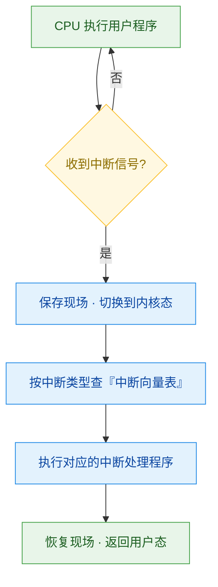
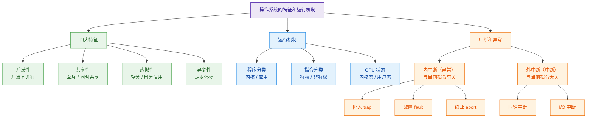

# 操作系统的特征和运行机制

> 概述：本篇梳理**操作系统「是什么样」（四大特征）**与**「怎么运转」（运行机制）**两件事，把零散概念串成一条主线：
> **四大特征（并发 · 共享 · 虚拟 · 异步）→ 运行机制（程序分类 · 指令分类 · CPU 状态）→ 中断与异常（态切换的唯一入口）**。

---

## 一、核心概念：操作系统的四大特征

一句话结论：现代操作系统有**并发、共享、虚拟、异步**四大特征，其中**并发和共享互为存在条件**，是后两者的基础。

| 特征 | 一句话定义 | 关键点 |
| --- | --- | --- |
| 并发性 | 同一**时间间隔**内，多个程序宏观上同时、微观上交替运行 | 与「并行」易混 |
| 共享性 | 系统资源可供内存中多个**并发执行**的进程共同使用 | 分互斥共享 / 同时共享 |
| 虚拟性 | 把一个**物理实体**变为若干**逻辑对应物** | 空分复用 / 时分复用 |
| 异步性 | 进程走走停停、以**不可预知的速度**推进 | 需保证「结果可再现」 |

### 1. 并发性

- **并发（Concurrency）**：指两个或多个事件在**同一时间间隔内**发生——宏观上「同时」，微观上「交替」。
- **并行（Parallelism）**：指两个或多个事件在**同一时刻**同时发生。

| 对比项 | 并发 | 并行 |
| --- | --- | --- |
| 时间维度 | 同一时间**间隔**内 | 同一**时刻** |
| 微观执行 | 交替进行 | 真正同时进行 |
| 硬件要求 | 单核即可 | 必须**多核**（或流水线） |
| 关系 | 并行是并发的**一种**特例 | 并发是并行的**上位**概念 |

> [!note] 操作系统中的并发性
> 指计算机系统中**同时存在多个运行的程序**（宏观同时、微观交替）。只有在**多核 CPU 且程序数 < 核数**时，才可能真正**并行**执行。

### 2. 共享性

共享即资源共享：系统中的资源可供内存中**多个并发执行的进程**共同使用。分两种方式：

| 共享方式 | 含义 | 典型资源 |
| --- | --- | --- |
| 互斥共享 | 一段时间内只允许**一个**进程访问 | 打印机、摄像头（临界资源） |
| 同时共享 | 一段时间内允许多个进程**宏观同时**访问 | 磁盘文件、可重入代码 |

### 3. 虚拟性

把一个物理实体变为若干个逻辑上的对应物。核心技术是**多路复用**：

- **空分复用**：把一个物理存储空间变为多个逻辑空间 —— 如**虚拟存储器**。
- **时分复用**：把一段物理时间变为多个逻辑时间 —— 如**虚拟处理器**。

### 4. 异步性

进程的异步性：允许程序在并发执行时，**不是「一贯到底」，而是走走停停**，以不可预知的速度向前推进。

> 只要**运行环境 / 初始条件相同**，操作系统需保证程序的多次运行**结果一致**——否则并发就没有工程价值。

---

## 二、运行机制

主线：**程序分两类 → 指令分两类 → CPU 处于两种状态**，三者严格对应。

### 1. 程序分类

| 类别 | 说明 |
| --- | --- |
| 内核程序 | 组成**操作系统内核**，是操作系统的**核心部分**，运行在底层 |
| 应用程序 | 程序员编写的普通程序 |

### 2. 指令分类

| 类别 | 谁能执行 | 示例 |
| --- | --- | --- |
| 特权指令 | **仅内核程序** | I/O 指令、置时钟、修改 PSW、关中断 |
| 非特权指令 | 内核程序 + 应用程序 | 普通算术 / 访存指令 |

> 应用程序**只能使用非特权指令**。**程序的运行，本质上就是 CPU 执行机器指令的过程。**

### 3. CPU 状态

| 状态 | 别名 | 正在执行 | PSW 标志位 |
| --- | --- | --- | --- |
| 内核态 | 管态 / 核心态 | **特权指令** | `1` |
| 用户态 | 目态 | 非特权指令 | `0` |

- 区分依据：CPU 中有一个**程序状态字寄存器（PSW）**，其中某一位为 `1` 表示内核态，`0` 表示用户态。

### 4. 两种状态的切换

| 方向 | 触发方式 | 说明 |
| --- | --- | --- |
| 内核态 → 用户态 | 执行一条**特权指令**（修改 PSW） | 由内核主动「交权」 |
| 用户态 → 内核态 | **中断** | 中断是**唯一途径** |

---

## 三、中断和异常（原理 / 流程）

> **中断的作用**：中断是让操作系统内核**夺回 CPU 使用权的「唯一途径」**。

### 1. 分类

按**中断信号来源**分为内中断（异常）和外中断（狭义的中断）：

| 对比项 | 内中断（异常） | 外中断（中断） |
| --- | --- | --- |
| 信号来源 | **CPU 内部** | **CPU 外部** |
| 与当前指令 | **有关** | **无关** |
| 典型例子 | 陷入、故障、终止、非法特权指令 | 时钟中断、I/O 中断 |

### 2. 内中断（异常）细分

1. **陷入（trap）**：由程序**主动**引发（如系统调用通过陷入指令发起）。
2. **故障（fault）**：如缺页、除零等，可能被修复后重执行。
3. **终止（abort）**：致命错误，无法继续。

> 两条常见内中断来源：
> ① 应用程序执行**特权指令**时主动引发内中断；
> ② 应用程序执行**陷入指令**（主动归还 CPU 使用权，**系统调用即由此实现**）。

### 3. 外中断（狭义的中断）

1. **时钟中断**：时钟部件每隔一个时间片向 CPU 发送时钟中断信号。
2. **I/O 中断**：由输入 / 输出设备发出的中断信号。

![[Pasted image 20261013235841.png|700]]

### 4. 中断机制的基本原理

不同的中断信号，由不同的内核程序负责处理。处理后流程如下：

> CPU 接收到中断信号后，会**切换到内核态**，并根据中断类型查询**「中断向量表」**，执行对应的处理程序（显然为内核程序）。

---

## 四、知识点总览（表 + 图）

### 1. 汇总表

| 模块 | 知识点 | 核心要点 | 易错提醒 |
| --- | --- | --- | --- |
| 特征 | 并发 vs 并行 | 并发＝时间间隔内；并行＝同一时刻 | 并发≠并行，并行必然并发 |
| 特征 | 共享 | 互斥共享 / 同时共享 | 并发与共享互为存在条件 |
| 特征 | 虚拟 | 空分复用 / 时分复用 | 虚拟存储器属空分复用 |
| 特征 | 异步 | 走走停停、速度不可预知 | 结果需可再现 |
| 机制 | 程序分类 | 内核程序 / 应用程序 | 内核是核心部分 |
| 机制 | 指令分类 | 特权指令 / 非特权指令 | 应用程序只能用非特权 |
| 机制 | CPU 状态 | 内核态（PSW=1）/ 用户态（PSW=0） | 靠 PSW 一位区分 |
| 机制 | 态切换 | 内→用：特权指令；用→内：中断 | 用户态→内核态只能靠中断 |
| 中断 | 内中断 | 与当前指令有关 | 陷入 / 故障 / 终止 |
| 中断 | 外中断 | 与当前指令无关 | 时钟中断、I/O 中断 |
| 中断 | 系统调用 | 通过**陷入指令**实现 | 属于内中断 |

### 2. 知识结构图

---

## 五、易错点 / 注意事项

- **并发 ≠ 并行**：并发是「同一时间间隔」、微观交替；并行是「同一时刻」、真正同时，需要多核。
- **并发与共享互为存在条件**：没有共享就无需并发，没有并发也就谈不上共享。
- **应用程序不能执行特权指令**；一旦执行会触发**内中断**。
- **用户态 → 内核态的切换只能由中断引发**，这是内核夺回 CPU 使用权的唯一途径。
- **系统调用通过陷入指令（trap）实现**，本质上属于**内中断**。
- 区分「异常 / 内中断」与「中断 / 外中断」：看信号**来源**和**是否与当前指令有关**。

---

## 六、小结

- 四大特征：**并发、共享、虚拟、异步**，并发与共享为基。
- 运行机制三件套：**程序分类、指令分类、CPU 状态**，一一对应。
- **中断是内核夺回 CPU 使用权的唯一途径**，并驱动内核态 / 用户态切换。
- 中断分**内中断（异常）**与**外中断（中断）**，靠来源区分。

---

## 相关笔记

- [[README]] —— 仓库主页 / 知识库总览
- 操作系统 `_MOC`（知识库总览）尚未创建，创建后在此链接
- 上一篇：操作系统的概念与功能 ｜ 下一篇：操作系统的发展历程

---

- **知识库总览**：[[README]]
- **仓库主页**：[[README]]
