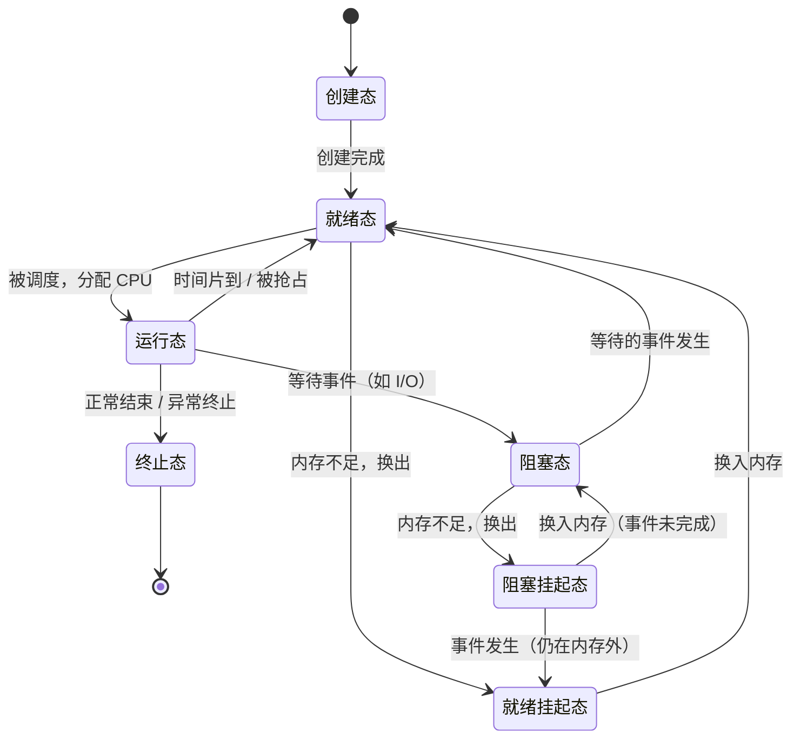

# 进程

> 概述：进程是操作系统**资源分配的基本单位**。本篇梳理**进程是什么（定义 / 特征）→ 由什么组成 → 怎么运行 → 状态与转换 → 进程控制（原语）→ 进程通信（IPC）**。

---

## 一、什么是进程

**定义**：进程是程序在某个数据集上的一次**执行过程**，是系统进行**资源分配**的基本单位。

**进程 vs 程序**：

| 对比项 | 程序 | 进程 |
| --- | --- | --- |
| 性质 | **静态**的，存放在硬盘中的可执行文件 | **动态**的，是程序的一次执行过程 |
| 组成 | 一系列指令的集合 | PCB + 程序段 + 数据段 |
| 生命周期 | 长期存在 | 有创建 → 活动 → 消亡的过程 |
| 对应关系 | 一个程序可对应多个进程 | 一个进程也可执行多个程序 |

> 进程是分配系统资源（含内存地址空间）的单位，因此**各个进程拥有独立的内存地址空间**。

### 进程的五大特征

| 特征 | 说明 |
| --- | --- |
| 动态性 | 进程是程序的一次执行，有创建 / 活动 / 消亡的过程——**最基本的特征** |
| 并发性 | 多个进程实体同存于内存中，能在一段时间内同时运行 |
| 独立性 | 进程是能独立运行、独立获得资源、独立接受调度的基本单位 |
| 异步性 | 各进程以各自独立的、不可预知的速度推进，需保证结果可再现 |
| 结构性 | 进程实体由 PCB、程序段、数据段组成 |

---

## 二、进程的组成

进程实体（进程映像）由三部分组成：

| 组成 | 归属 | 内容 |
| --- | --- | --- |
| **PCB**（进程控制块） | 操作系统使用 | 进程描述信息（PID、UID）、资源分配、运行情况（状态）等 |
| **程序段** | 进程自身使用 | 程序的代码（指令序列） |
| **数据段** | 进程自身使用 | 运行过程中产生的各种数据（如变量） |

- **PCB**：操作系统管理进程所需的全部信息都保存在 **PCB（进程控制块）** 这一数据结构中。例如进程切换时，CPU 会把现场信息保存到 PCB，以便该进程再次执行时恢复现场。
- **PCB 是进程存在的唯一标志**；操作系统通过 PCB 来感知进程的存在。

---

## 三、程序怎么运行的？

![[Pasted image 20261014162536.png|641]]

---

## 四、进程的状态与转换

### 1. 七种状态

进程共有七种状态：其中「创建态、就绪态、运行态、阻塞态、终止态」是五种**基本状态**，另外两种是**挂起态**（阻塞挂起、就绪挂起）。^4fe9cd

| 状态 | 含义 |
| --- | --- |
| 创建态 | 系统正在创建进程，尚未就绪 |
| 就绪态 | 进程已创建完成，位于**就绪队列**中等待 CPU |
| 运行态 | 进程正占用 CPU 执行 |
| 阻塞态 | 进程正等待某个事件（如 I/O），即便给它 CPU 也无法运行 |
| 阻塞挂起态 | 内存不够且进程处于阻塞态时，被换出到外存（交换区）挂起 |
| 就绪挂起态 | 因内存不够被换出到外存，但所有条件已满足，换入内存后即可运行 |
| 终止态 | 进程通过 `exit` 系统调用请求终止并回收资源 |

### 2. 状态转换



![[Pasted image 20261014202301.png]]

> [!note] 不可能发生的直接转换
> - **阻塞态 → 运行态**：阻塞态必须先回到就绪态，再由调度器分配 CPU。
> - **就绪态 → 阻塞态**：就绪态必须先获得 CPU 才能因等待事件而进入阻塞态。

### 3. 阻塞和挂起的区别

- **阻塞**：进程仍在**主存**中，正在等待某个事件发生；即便 CPU 空闲也不能执行。
- **挂起**：因内存不够等原因，进程被**移出主存到外存**，此时进程**不在内存中**。

---

## 五、进程控制——实现进程状态的转换

### 1. 原语

- **原语**是一种特殊的程序，其执行具有**原子性**：要么完整做完，要么完全不做。
- **进程的状态转换必须用原语完成**，以防止信息不统一使系统出错。
- 原语的**原子性**由**关中断指令**与**开中断指令**这两个**特权指令**实现：
  - **关中断指令**：关闭 CPU「每执行完一条指令就检查中断」的行为——**此后不再检查中断**；
  - **开中断指令**：重新开启该行为；
  - 两条指令之间的指令序列即为**原子操作**。

### 2. 进程控制相关的原语

| 原语 | 作用 |
| --- | --- |
| 创建原语 | 创建进程 |
| 撤销原语 | 终止进程 |
| 阻塞原语 | 阻塞进程 |
| 唤醒原语 | 唤醒进程 |
| 切换原语 | 从当前进程切换到另一个进程 |

---

## 六、进程通信（IPC）

进程拥有**独立的内存地址空间**，为使进程之间能够通信，常用以下四种方法：

### 1. 消息传递

以**格式化消息**为单位交换数据，使用**发送消息 / 接收消息**两个**原语**。

- **直接通信**：发送进程通过**发送原语**指定接收进程的 **PID** 发送消息；接收进程通过**接收原语**从自己 PCB 的**消息队列**中获取消息。
- **间接通信（信箱通信）**：发送进程通过**发送原语**指定**信箱**（中间实体）发送消息；接收进程通过**接收原语**从指定**信箱**获取消息。

### 2. 管道通信

- 管道是一个特殊的**共享文件**，在内存中开辟一个大小固定、**单向**的**内存缓冲区（循环队列）**。
- 读写**互斥**，读写顺序为 **FIFO**。
- **管道满 → 写进程阻塞；管道空 → 读进程阻塞。**
- 管道只能**半双工**通信，不能同时收发；要实现**全双工**需使用两个管道。

### 3. 共享内存

- 操作系统为进程提供一块**共享内存区**，通过**增加页表项 / 段表项**将同一块内存映射到各进程的地址空间。
- 需要实现**互斥访问**。

| 共享方式 | 说明 | 通信方式等级 |
| --- | --- | --- |
| 基于**存储区** | 划出一块共享存储区，数据的格式与位置由**通信进程**自行控制，OS 不限制 | 高级通信方式（快、限制少） |
| 基于**数据结构** | 共享空间中只能放固定结构（如固定长度数组） | 低级通信方式（慢、限制多） |

### 4. 信号

信号用于通知进程某个事件发生；进程收到信号后会对其进行处理。

**发送与保存原理**（在 PCB 中）：

- 保存有**待处理信号 `pending`** 与**被阻塞信号 `blocked`（阻塞掩码，用于屏蔽信号）**标志位。
- 收到特定信号时，`pending` 中对应标志位置 1（重复信号忽略）；再与阻塞掩码取反后相与，判断该信号是否需要真正处理：`pending & (~blocked)`。

> [!note] 什么时候处理信号？
> 当进程**从内核态返回用户态**时，会检查是否有待处理信号，有则处理。

**信号处理**：

- 每个信号都有一个默认处理程序（有的默认为空，即忽略）。
- CPU 会执行该进程对该信号的自定义处理程序（无自定义时用默认处理程序）。
- 处理完成后将 `pending` 置 0，并返回下一条指令继续执行。
- **优先处理序号更小的信号。**
- 注意：有些信号**既不能被自定义处理，也不能被阻塞**，例如 Linux 的 `SIGKILL`、`SIGSTOP`。

### 5. 信号和异常

信号可作为异常的配套机制，对操作系统的异常处理进行补充。有些异常无法由内核全部处理，还需用户进程配合。


# 七、进程同步和进程互斥

## 什么是进程同步？
进程同步用来解决进程异步性的问题。
即使并发情况下的各个进程的执行顺序是可控的，按照某种顺序协调其工作次序。
例如管道通信时需要保证写进程在前，读进程在后。

## 进程互斥

一个时间段内，仅允许一个进程进行访问的资源：临界资源。临界区就是访问临界资源的代码。
通过互斥标志位/互斥锁等操作实现。

==🟠一个互斥访问可以分为：
```
进入区： 检查是否可以进入临界区，如果可以，设置标志位，”上锁“
临界区： 访问临界资源
退出区： 解除标志位，“解锁”
剩余区： 做其他处理
```

分为以下原则：
1. 空闲让进
2. 忙则等待
3. 有限等待（保证不会饥饿）
4. 让权等待（防止进程忙等待占用处理机）

## 进程互斥的软件实现方法

主要依靠标志位（*互斥锁*）/ **信号量机制** 实现
信号量机制查看：[[信号量机制]]

### 单标志位

使用一个表示当前允许进入临界区的进程号`int turn = 1; // 表示当前允许进入临界区的PID`
每个进程进入临界区的权限只能由另外一个进程赋予
违背了**空闲让进**原则，容易造成*空闲未进*
### 双标志位先检查
使用标志位数组标记各个进程进入临界区的意愿。
先检查，后上锁
每个进程进入时优先检查其他标志位的标志
如果未实现原子CAS检查操作，违背**忙则等待**

### 双标志位后检查
先上锁，后检查
容易造成*死锁*导致的*饥饿*
违背**空闲让进**和**有限等待**

### Peterson算法

综合单标志CAS（优先进程PID）+标志位数组（进程使用意愿）
容易造成**忙等**，违背**让权等待** 

## 进程互斥的硬件实现方法
### TestAndSet(Lock)指令
通过**硬件**实现，适用于多处理机。
阻塞并等待标志位变更后设置标志位
容易造成**忙等**，不满足**让权等待**
### Swap指令
通过硬件实现，将两个变量值交换。
阻塞并等待标志位变更后交换
容易造成**忙等**，不满足**让权等待**


---

## 七、易错点 / 注意事项

- **进程是资源分配的基本单位，线程是 CPU 调度的基本单位**——两者不要混。
- **PCB 是进程存在的唯一标志**，进程的组成是「PCB + 程序段 + 数据段」三部分。
- **阻塞 ≠ 挂起**：阻塞仍在内存、等事件；挂起是被换出到外存、不在内存。
- **阻塞态不能直接转到运行态，就绪态不能直接转到阻塞态**。
- **原语靠「关中断 / 开中断」实现原子性**，本身是特权指令。
- **管道是半双工**，全双工需两个管道；满则写阻塞、空则读阻塞。
- **`SIGKILL`、`SIGSTOP` 不可被自定义或阻塞**。

---

## 八、小结

- 进程 = 程序的一次执行，是**资源分配**的基本单位，拥有**独立地址空间**。
- 组成：**PCB（OS 用）+ 程序段 + 数据段**；PCB 是进程存在的唯一标志。
- 七种状态：创建 / 就绪 / 运行 / 阻塞 / 终止（基本）+ 阻塞挂起 / 就绪挂起。
- 状态转换由**原语**完成，原语靠**关中断 / 开中断**保证原子性。
- IPC 四法：**消息传递、管道、共享内存、信号**。

---

## 相关笔记

- [[README]] —— 仓库主页 / 知识库总览
- [[线程]] —— CPU 调度的基本单位，与进程的区别
- [[调度]] —— 进程调度（就绪队列 → 处理机）
- [[系统调用]] —— 进程控制 / 通信所依赖的接口
- [[操作系统的特征和运行机制]] —— 内核态 / 用户态、中断、原语
- 操作系统 `_MOC`（知识库总览）尚未创建，创建后在此链接

---

- **知识库总览**：[[README]]
- **仓库主页**：[[README]]
