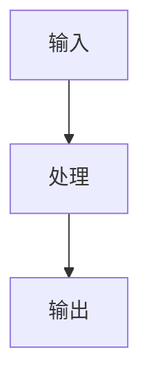
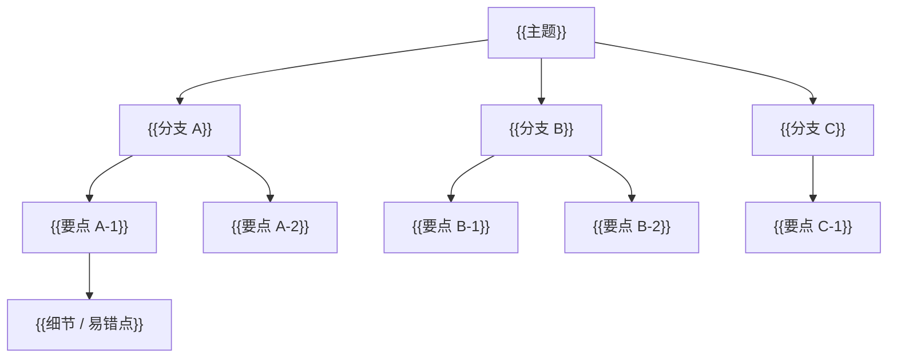

# {{title}}

> 概述：用一两句话说明**这篇笔记解决什么问题**，再补一句本页要梳理的主线（覆盖哪几块内容）。

---

> [!summary]- 目录
> - [[#一、{{核心概念 / 是什么}}]]
>   - [[#{{小节标题 1}}]]
>   - [[#{{小节标题 2}}]]
> - [[#二、{{原理 / 流程}}]]
>   - [[#{{小节标题 1}}]]
> - [[#三、{{代码 / 实践}}]]
> - [[#四、易错点 / 注意事项]]
> - [[#五、小结]]
> - [[#相关笔记]]

> [!tip] 目录使用说明
> - 目录使用 Obsidian 原生内部链接 `[[#标题]]`，点击即可**跳转到对应文本块**，无需插件。
> - **链接文字必须与标题文字完全一致**（含编号、空格、`==高亮==`），否则链接会失效。
> - 一般只收录 `##`（二级标题），有需要时再缩进收录 `###`（三级标题）；标题过多时可只列二级标题。
> - 折叠状态：`> [!summary]- 目录` 默认收起；改成 `> [!summary]+ 目录` 则默认展开。

---

## 一、{{核心概念 / 是什么}}

（先用一句话给结论，再展开。善用表格做对比，善用代码块贴最小示例。）

| 对比项 | A | B |
| --- | --- | --- |
|  |  |  |

```cpp
// 最小可运行示例，注明语言
```

> [!note] 补充说明
> 需要强调的前提、结论或工程经验写在这里。

---

## 二、{{原理 / 流程}}

用流程图或分步骤讲清「怎么做」，必要时用 Mermaid。
**方向优先纵向（`TB` / `TD`），避免横向图过长、撑出屏幕：**



### 结构图示例（知识点结构 / 知识图谱）

用**树形结构图**把一整块知识的层级关系画出来，复习时一眼看清全局：
在能够详细展示结构的前提下，尽量使用**纵式树**而不是横式，确保能够完整展示结构



> [!note] Mermaid 写法要点
> - 节点文字**一律加引号**：`A["文本"]`，含空格 / 括号 / 换行更保险。
> - 换行用 `<br/>`：`A1["并发性<br/>并发 ≠ 并行"]`。
> - 方向：**默认纵向** `flowchart TB` / `TD`；`LR`（横向）只在节点很少（≤3）时才用，否则图会横向过长。
> - 可选样式：加 `classDef` 上色，或用 `subgraph` 分组，例如
>   `subgraph 特征["四大特征"]` … `end`。

---

## 三、{{代码 / 实践}}

```cpp
// C++ 示例
```

```python
# Python 示例
```

---

## 四、易错点 / 注意事项

- 易错点
==🔴== ==🔴易错点

---

## 五、小结

- 
- 

---

## 相关笔记

- [[...]] —— 关联说明

---

- **知识库总览**：[[上位机学习/_MOC]]
- **仓库主页**：[[README]]
