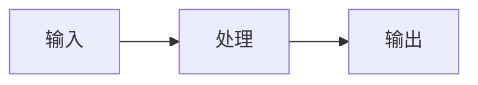

# {{title}}

> 概述：用一两句话说明**这篇笔记解决什么问题**，再补一句本页要梳理的主线（覆盖哪几块内容）。

---

## 一、{{核心概念 / 是什么}}

（先用一句话给结论，再展开。善用表格做对比，善用代码块贴最小示例。）

| 对比项 | A | B |
| --- | --- | --- |
|  |  |  |

```cpp
// 最小可运行示例，注明语言
```

> [!note] 补充说明
> 需要强调的前提、结论或工程经验写在这里。

---

## 二、{{原理 / 流程}}

用流程图或分步骤讲清「怎么做」，必要时用 Mermaid：



---

## 三、{{代码 / 实践}}

```cpp
// C++ 示例
```

```python
# Python 示例
```

---

## 四、易错点 / 注意事项

- 

---

## 五、小结

- 
- 

---

## 相关笔记

- [[...]] —— 关联说明

---

- **知识库总览**：[[上位机学习/_MOC]]
- **仓库主页**：[[README]]
