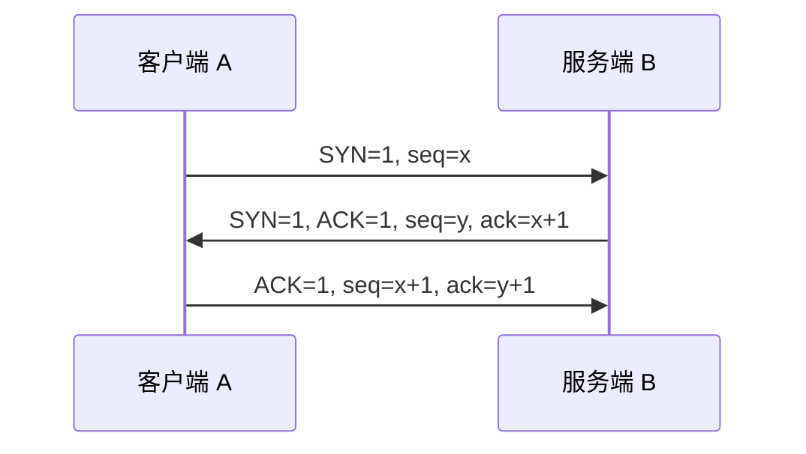
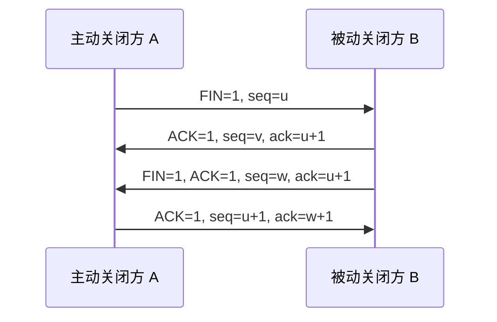

# 传输层：UDP 与 TCP

> 传输层职责，以及 UDP 与 TCP 的连接、可靠性、首部与适用场景对比。
> 主线：**传输层职责与端口 → UDP 的特点与首部 → TCP 的首部、连接管理与传输机制 → 两者对比与易错点**。

> [!summary]- 目录
> - [[#一、传输层概述]]
>   - [[#1. 位置与职责]]
>   - [[#2. 端口与套接字]]
>   - [[#3. 复用与分用]]
>   - [[#4. 差错检测]]
> - [[#二、UDP：无连接服务]]
>   - [[#1. 主要特点]]
>   - [[#2. 数据报格式]]
>   - [[#3. 检验和]]
>   - [[#4. 典型应用场景]]
> - [[#三、TCP：面向连接服务]]
>   - [[#1. 主要特点]]
>   - [[#2. 数据报格式（首部）]]
>   - [[#3. 三次握手与四次挥手]]
>   - [[#4. 可靠传输、流量控制与拥塞控制]]
> - [[#四、UDP 与 TCP 对比]]
> - [[#五、易错点 / 注意事项]]
> - [[#六、小结]]
> - [[#相关笔记]]

---

## 一、传输层概述

### 1. 位置与职责

传输层位于**应用层与网络层之间**：向下使用网络层提供的 IP 服务，向上为应用层提供进程间的逻辑通信。

- 网络层实现**主机到主机**的通信，IP 数据报首部只有源 IP、目的 IP；
- 传输层实现**端到端（进程到进程）** 的通信，TCP/UDP 首部用源端口、目的端口区分进程。

> [!note] 端到端 vs 点到点
> 「端到端」指**进程到进程**，「点到点」指**相邻节点到相邻节点**（数据链路层）。网络层只说「主机到主机」，它不关心数据最终交给哪个进程。

传输层的主要功能：

1. 为应用进程提供**逻辑通信**（进程间通信）；
2. **复用与分用**；
3. **差错检测**（UDP 可选、TCP 必做）；
4. **流量控制**（TCP，端到端）；
5. **连接管理**（TCP 的建立与释放）。

两个进程通信必须指明四样东西：**传输层协议**、**本进程绑定的端口号**、**对方 IP 地址**、**对方端口号**。

### 2. 端口与套接字

**端口号**是 16 位、只在本主机内有意义的进程标识，范围 0–65535，分三类：

| 类别        | 范围          | 说明                                              |
| --------- | ----------- | ----------------------------------------------- |
| **熟知端口**  | 0–1023      | 重要系统服务，如 FTP 21、SSH 22、DNS 53、HTTP 80、HTTPS 443 |
| 登记端口      | 1024–49151  | 需向 IANA 登记，供普通服务使用                              |
| 动态 / 私有端口 | 49152–65535 | 客户端临时使用，连接结束即释放                                 |

**套接字（Socket）** 用 `IP:端口` 标识；一条 TCP 连接由**四元组**唯一确定：`(源 IP, 源端口, 目的 IP, 目的端口)`。

> [!note] TCP 与 UDP 的端口空间相互独立
> TCP 的 80 和 UDP 的 80 是两个不同的端口，同一主机上可以同时被占用。看到「端口号」时，先确认是哪种协议。

### 3. 复用与分用

- **复用**：发送方同一主机上的多个应用进程，共用同一个传输层协议发送数据（**从上往下**）。
- **分用**：接收方传输层根据首部中的端口号，把数据正确交付给对应进程（**从下往上**）。

### 4. 差错检测

- **TCP**：检测到差错就丢弃该报文段，并依靠**确认与超时重传**机制通知发送方重传。
- **UDP**：检测到差错就丢弃，**不通知发送方**，可靠性交给应用层自行实现。

---

## 二、UDP：无连接服务

### 1. 主要特点

- **无连接**：发送前不建连接，每个报文独立寻址；
- **不可靠**：不保证到达、不保证顺序、不保证不重复；
- **面向报文**：一次发送一个完整报文，**保留报文边界**，不合并、不拆分；
- **无拥塞控制**：网络拥塞时照常发送，适合实时业务；
- **首部小**：固定 **8 B**；
- **支持一对一、一对多**：可发送广播（如 `255.255.255.255`、子网定向广播）与组播。

> [!note] 「UDP 不分片」的准确说法
> UDP **自身**不拆分报文；但报文交给 IP 层后，若超过 MTU，**IP 层仍会分片**，重组只在目的主机进行。只有当报文长度超过 UDP 长度字段上限（65535 B，含 8 B 首部）时，才根本无法封装，发送直接失败。

### 2. 数据报格式

首部固定 **8 B（64 bit）**，四个字段各 16 位：

| 字段 | 长度 | 说明 |
| --- | --- | --- |
| 源端口号 | 16 bit | 不需要对方回复时可全 0 |
| 目的端口号 | 16 bit | 必填 |
| UDP 长度 | 16 bit | 首部 + 数据的总字节数，最小 8，最大 65535 |
| UDP 检验和 | 16 bit | 检测比特差错；IPv4 下全 0 表示**不校验** |

因此 UDP 数据部分最大为 `65535 − 8 = 65527 B`；再减去 IPv4 首部 20 B，实际可发送的最大载荷为 **65507 B**。

### 3. 检验和

计算范围是 **伪首部 + UDP 首部 + 数据**，伪首部共 12 B：源 IP（4 B）、目的 IP（4 B）、全 0（1 B）、协议号 17（1 B）、UDP 长度（2 B）。伪首部只参与计算，**不随报文传输**。

生成与验证：

1. 发送方把参与计算的内容按 **16 bit** 分组，做**反码求和**（最高位进位**回卷**加到最低位），结果**逐位取反**即检验和；
2. 接收方把收到的全部内容（含检验和字段）按同样方法求和再取反：结果为 **0** 说明无差错，为**全 1** 也说明校验通过（两种表述等价，取决于是否把检验和字段取反后相加）。

> [!note] 为什么需要伪首部
> 伪首部把源/目的 IP 也纳入校验，使 UDP 能间接发现「IP 地址错误导致交付到错误主机」的情况。TCP 的检验和同样包含伪首部。

### 4. 典型应用场景

DNS（53）、DHCP（67/68）、TFTP（69）、SNMP（161）、音视频流、实时游戏、广播 / 组播。

---

## 三、TCP：面向连接服务

### 1. 主要特点

- **面向连接**：通信前三次握手，结束后四次挥手；
- **可靠**：序号 + 确认 + 重传 + 校验，保证**不丢、不重、不乱序**；
- **面向字节流**：把应用数据看作无结构的字节流，按 **MSS** 自动分段与重装；
- **全双工**：双方可同时发送数据；
- **一对一**：每条连接只有两个端点，**不支持广播 / 组播**；
- **支持流量控制与拥塞控制**；
- **首部较大**：20–60 B。

**MSS（最大段长）**：一个 TCP 报文段最多能携带的**数据**字节数，**不含首部**，在 SYN 段的选项字段中协商（常见取值 = MTU − 40）。

### 2. 数据报格式（首部）

固定部分 20 B，选项最多 40 B，总长 20–60 B。

| 字段          | 长度     | 说明                                         |
| ----------- | ------ | ------------------------------------------ |
| 源端口         | 16 bit |                                            |
| 目的端口        | 16 bit |                                            |
| **序号 seq**  | 32 bit | 本报文段**数据**第一个字节在原始字节流中的位置（SYN 段中为初始序号 ISN） |
| **确认号 ack** | 32 bit | 期望收到的**下一个字节**序号；`ACK=1` 时才有效              |
| 数据偏移        | 4 bit  | 首部长度，**单位为 4 B**，故范围为 20–60 B              |
| 保留          | 6 bit  | 按教材为保留位；现代实现中 3 位已被 NS / CWR / ECE 占用      |
| 标志位         | 6 bit  | URG、ACK、PSH、RST、SYN、FIN，见下表                |
| **窗口 rwnd** | 16 bit | 接收方还能接收的字节数，**流量控制的关键**                    |
| 检验和         | 16 bit | 覆盖伪首部 + TCP 首部 + 数据，**必填**                 |
| 紧急指针        | 16 bit | 仅在 `URG=1` 时有效，指出紧急数据末尾位置                  |
| 选项          | 0–40 B | 协商 MSS、窗口扩大因子、SACK 等                       |
| 填充          | 0–3 B  | 使首部长度为 4 B 的整数倍                            |

标志位含义：

| 标志      | 名称  | 含义                            |
| ------- | --- | ----------------------------- |
| URG     | 紧急  | 1 表示有紧急数据，紧急指针有效              |
| **ACK** | 确认  | 1 表示**确认号字段有效**（连接建立后通常恒为 1）  |
| PSH     | 推送  | 1 表示接收方应**尽快把数据交付应用层**，不等缓冲区满 |
| RST     | 复位  | 出现严重差错或拒绝连接，需**重建 / 释放连接**    |
| **SYN** | 同步  | 1 表示**连接请求或接受连接请求**，同时同步初始序号  |
| **FIN** | 终止  | 1 表示**本端数据已发完**，请求释放连接        |

> [!note] 标志位与报文段命名
> 报文段常按置位的标志命名：含 `SYN=1` 的叫 **SYN 段**，只含 `ACK=1` 的叫 **ACK 段**，含 `FIN=1` 的叫 **FIN 段**。

**TCP 首部中没有「数据长度」字段**：TCP 数据长度 = IP 总长度 − IP 首部长度 − TCP 首部长度。

### 3. 三次握手与四次挥手

**三次握手**（客户端 A，服务端 B）：

- 第 1 次：`SYN=1, ACK=0, seq=x`，**不携带数据，但消耗一个序号**；
- 第 2 次：`SYN=1, ACK=1, seq=y, ack=x+1`，同时**协商 MSS**；
- 第 3 次：`ACK=1, seq=x+1, ack=y+1`，**可以携带数据**。

为什么是三次：既能防止**已失效的连接请求**突然到达服务端而造成资源浪费，又能让双方都确认「自己的发送能力」和「对方的接收能力」正常，并同步双方的初始序号。

**四次挥手**：

- 收到 FIN 只表示对方**不再发数据**，本端仍可继续发送，因此是**半关闭**，需要两次 FIN 分别关闭两个方向，最终形成四次挥手；
- 主动关闭方最后进入 **TIME_WAIT**，等待 **2MSL** 后才真正关闭，用于保证最后一个 ACK 能到达，并让旧连接的残留报文段在网络中消失。

> [!note] 常见的标志位规律
> 握手第 1 次 `ACK=0`，其余报文段 `ACK=1`；
> 握手第 1、2 次 `SYN=1`；
> 挥手第 1、3 次 `FIN=1`。

### 4. 可靠传输、流量控制与拥塞控制

- **序号与确认**：接收方使用**累计确认**，`ack=n` 表示 n 之前的字节全部收到；
- **超时重传**：每段设置定时器，超时未确认即重传，RTO 根据 RTT 的加权平均值动态估算；
- **快速重传**：收到 **3 个重复 ACK** 时，不等超时立即重传丢失的段；
- **流量控制**：接收方通过首部中的 **rwnd** 通告剩余窗口，发送方据此限制发送量，防止淹没接收方；
- **拥塞控制**：发送方维护 **cwnd**，按「慢开始 → 拥塞避免 → 快重传 → 快恢复」调整，实际发送窗口取 `min(rwnd, cwnd)`。

> [!note] cwnd 不在首部里
> **接收窗口 rwnd** 是首部字段，由接收方通告；**拥塞窗口 cwnd** 是发送方自己维护的状态变量，TCP 首部中**没有**对应字段。考试中常把两者混为一谈。

---

## 四、UDP 与 TCP 对比

| 对比项 | UDP | TCP |
| --- | --- | --- |
| 连接方式 | 无连接 | 面向连接（三次握手 / 四次挥手） |
| 可靠性 | 不可靠，不保证到达与顺序 | 可靠，不丢、不重、不乱序 |
| 数据形式 | 面向报文，保留边界 | 面向字节流，按 MSS 分段 |
| 首部大小 | 固定 8 B | 20–60 B |
| 传输方式 | 一对一、一对多（广播 / 组播） | 仅一对一 |
| 流量 / 拥塞控制 | 无 | 有（rwnd / cwnd） |
| 差错检测 | 可选（IPv4 下可为 0） | 必有 |
| 传输效率 | 高、时延小 | 较低，开销大 |
| 典型应用 | DNS、DHCP、音视频、游戏 | HTTP、FTP、SMTP、SSH |

---

## 五、易错点 / 注意事项

- ==🔴== **ACK 不是「建立连接」标志**：`ACK=1` 只表示确认号有效；建立连接靠 **SYN**。
- ==🔴== **PSH 不是「要求回复」**：它表示**尽快把数据交给应用层**，与是否回复无关。
- ==🔴== **TCP 首部不记录数据长度**，必须用 `IP 总长度 − IP 首部 − TCP 首部` 推算。
- ==🔴== **数据偏移记录的是TCP首部长度，单位是 4 B**，4 位最大为 15，所以首部最长 60 B。
- ==🔴== **`ack=n` 表示期望收到的下一个字节序号**，不是「已收到 n 个字节」；握手时应为 `seq+1`。
- ==🔴== **MSS 只统计数据**，不含首部；只在 SYN 段选项中协商。
- ==🔴== **UDP 检验和全 0 表示不校验**（IPv4），TCP 检验和必填；两者都覆盖**伪首部**。
- ==🔴== **UDP 面向报文，但 IP 层仍会分片**；分片重组只在目的主机完成。
- ==🔴== **TCP/UDP 端口空间独立**，同一个数字可在两种协议下同时使用。
- ==🔴== **残留的 6 位按教材记**，但现代实现中 NS / CWR / ECE 已占用 3 位，二者不矛盾。
- ==🔴== **TIME_WAIT 属于主动关闭方**，等待 2MSL；被动关闭方不进入该状态。

---

## 六、小结

- 网络层负责**主机到主机**，传输层负责**进程到进程**，靠端口号完成分用。
- UDP：**8 B 首部、无连接、不可靠、面向报文、支持一对多**，适合实时业务；校验和可省略，但包含伪首部。
- TCP：**20–60 B 首部、面向连接、可靠、面向字节流**；序号 / 确认号均 32 位，窗口 16 位。
- 连接管理：**三次握手防失效请求、四次挥手因半关闭**；主动关闭方进入 TIME_WAIT。
- 可靠性来自**序号 + 确认 + 超时重传 + 快速重传**；流量控制看 **rwnd**，拥塞控制看 **cwnd**，发送窗口取两者较小值。

---

## 相关笔记

- [[计算机网络分层]] —— 传输层在网络体系中的位置与各层职责
- [[IPv4分组(数据报)]] —— IP 首部字段，以及计算 TCP/UDP 数据长度所需的长度信息
- [[IP地址]] —— 源 / 目的 IP 与伪首部校验的关系
- [[计算机网络的组成和功能、交换技术]] —— 分组转发与传输层以下的基础
- [[README]] —— 仓库主页 / 知识库总览

---

- **知识库总览**：[[README]]
- **仓库主页**：[[README]]