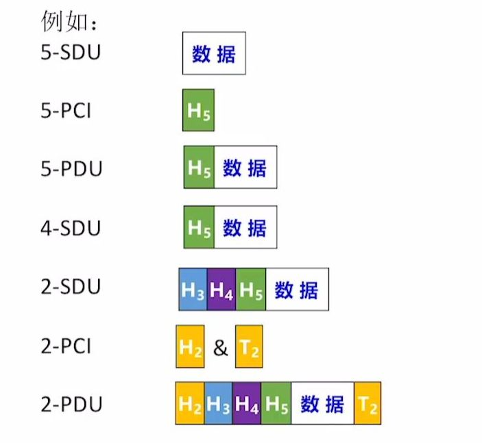
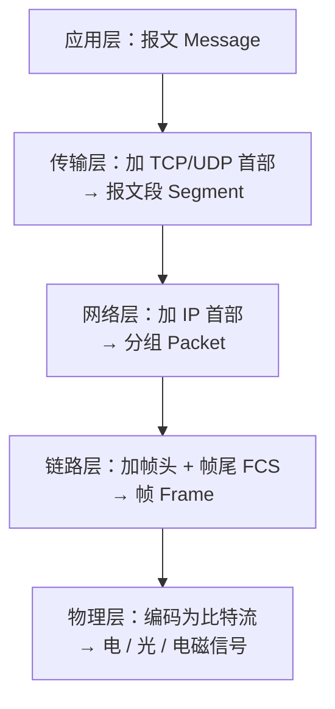
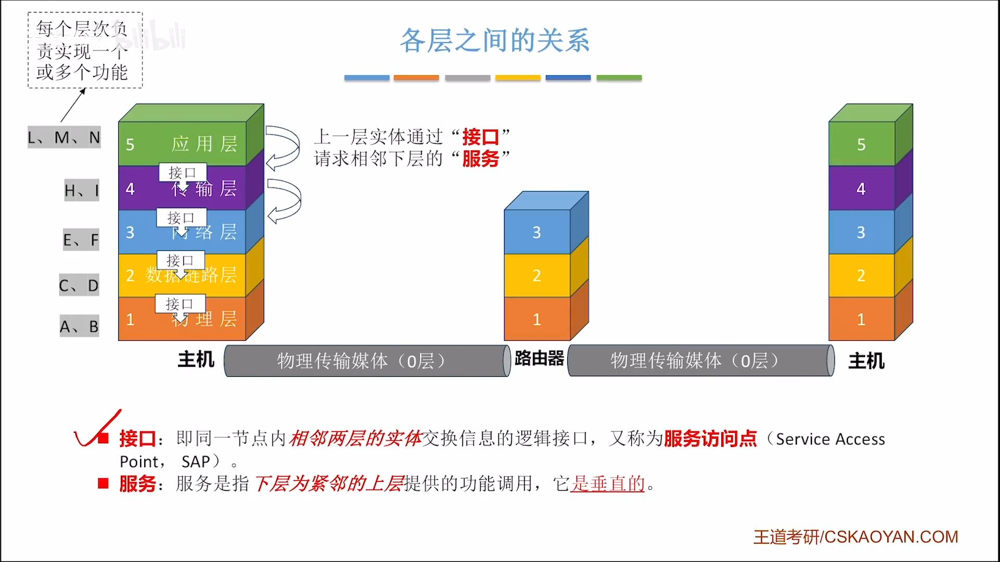
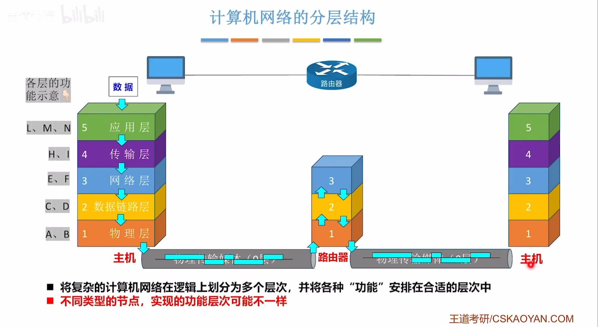

# 计算机网络分层

> 本篇回答「网络通信这么复杂，为什么要拆成一层层的、每层到底管什么」。
> 主线：**为什么要分层 → 基本概念（实体 / 协议 / 服务 / PDU）→ 五层模型逐层职责 → 四层模型（TCP/IP）→ OSI 七层与三者对应 → 两种模型的关键差异 → 一次完整的数据传输过程**。

> [!summary]- 目录
> - [[#一、为什么要分层]]
> - [[#二、分层结构的基本概念]]
>   - [[#1. 实体、对等层与对等实体]]
>   - [[#2. 协议、接口与服务]]
>   - [[#3. SDU、PCI、PDU 与封装]]
>   - [[#4. 网络协议三要素]]
> - [[#三、三种分层模型总览]]
> - [[#四、五层模型（教学模型）]]
>   - [[#1. 应用层]]
>   - [[#2. 传输层]]
>   - [[#3. 网络层（IP 层）]]
>   - [[#4. 数据链路层]]
>   - [[#5. 物理层]]
>   - [[#6. 五层模型总结]]
> - [[#五、四层模型（TCP/IP，事实标准）]]
> - [[#六、OSI 七层模型（理论标准）]]
> - [[#七、三种模型的对应关系]]
> - [[#八、五层模型与四层模型的关键差异]]
> - [[#九、一次完整的数据传输过程]]
> - [[#十、网络设备与层次归属]]
> - [[#十一、易错点 / 注意事项]]
> - [[#十二、小结]]
> - [[#相关笔记]]

---

## 一、为什么要分层

**分层**：把「两台主机上的进程如何通信」这个庞大问题，拆解成若干**相对独立、单向依赖**的子问题，每一层只解决其中一类问题。

| 好处 | 说明 |
| --- | --- |
| **解耦** | 每层只依赖相邻下层提供的**服务**，不关心其内部实现 |
| **独立演进** | 物理介质从双绞线换成光纤，上层 IP、TCP 一行代码都不用改 |
| **复用** | IP 层统一提供分组转发，TCP / UDP 都能共用 |
| **易标准化** | 各厂商只实现某一层，网卡、路由器、浏览器可来自不同厂家并协同工作 |

分层必须遵守的纪律：

1. **第 n 层只能使用第 n-1 层提供的服务，并只向第 n+1 层提供服务**——不能跨层直接调用。
2. **对等层之间用「协议」通信**，这是**逻辑上**的通信；数据实际仍要逐层向下传递，再逐层向上解封装。
3. **只有不同主机的同一层才叫对等层**；同一主机的上下层是「服务提供者 / 服务用户」关系。

> [!tip] 邮政类比
> 写信（应用层）→ 装信封写门牌（传输层端口）→ 分拣到城市、街道（网络层 IP）→ 装邮车逐段运输（链路层 MAC）→ 公路 / 铁路（物理层）。每一段投递员只关心「交给下一站」，不必了解全程路线。

---

## 二、分层结构的基本概念

### 1. 实体、对等层与对等实体

| 概念 | 定义 |
| --- | --- |
| **实体（Entity）** | 第 n 层中**活动着的元素**（软件 + 硬件），如浏览器的 HTTP 客户端、网卡 |
| **对等层（Peer Layer）** | **不同机器**上的同一层 |
| **对等实体（Peer Entity）** | 对等层中的实体，它们按协议**逻辑上直接对话** |
| **服务访问点（SAP）** | 同一节点内相邻两层交换信息的**逻辑接口**，如传输层的**端口号**就是应用层访问传输层的 SAP |

### 2. 协议、接口与服务

这三者是最常考的一组，务必分清方向：

| 概念 | 方向 | 作用范围 | 一句话 |
| --- | --- | --- | --- |
| **协议（Protocol）** | ==🔴水平== | **对等层**之间 | 通信双方共同遵守的**规则** |
| **接口（SAP）** | ==🟠垂直== | **同一节点**相邻两层 | 上下层交换信息的**逻辑出入口** |
| **服务（Service）** | ==🟠垂直== | **下层 → 紧邻上层** | 下层为上层提供的**功能调用** |

- **协议是水平的，服务是垂直的**——区分二者的口诀。
- **协议是「规则」，服务是「能力」**：本层协议的实现，才使得本层能向上层提供服务；上层看不见协议，只看见服务。
- 服务原语一般分四类：**请求（Request）、指示（Indication）、响应（Response）、证实（Confirm）**。
- 相邻层之间才有接口；**跨层没有接口**。

> [!warning] 常见误读
> 「服务」不是「协议的一部分」，也不是「某一层的功能列表」。服务强调**下层向上层提供什么**，不暴露实现细节；协议才规定**对等实体怎么做**。

### 3. SDU、PCI、PDU 与封装

- **SDU（服务数据单元）**：上层交下来的**数据本体**。
- **PCI（协议控制信息）**：本层加上去的**控制头（有时含尾部）**。
- **PDU（协议数据单元）**：本层在对等层之间实际传送的**完整单元**。

关系式：

```text
n-SDU  +  n-PCI  =  n-PDU  =  (n-1)-SDU
```

含义：**第 n 层的 PDU，向下交给第 n-1 层后，就成了第 n-1 层的 SDU**——这就是**封装（Encapsulation）**。接收方逐层去头，叫**解封装（Decapsulation）**。

各层 PDU 的名称：

| 层     | PDU 名称                               | 说明             |
| ----- | ------------------------------------ | -------------- |
| 应用层   | **报文 / 消息**（Message）                 | 具体格式由应用协议决定    |
| 传输层   | **报文段**（Segment，TCP）/ **用户数据报**（UDP） | 加源 / 目的端口等     |
| 网络层   | **分组 / 数据报**（Packet / Datagram）      | 加源 / 目的 IP     |
| 数据链路层 | **帧**（Frame）                         | 加帧头、帧尾（FCS）    |
| 物理层   | **比特**（Bit）                          | 无「首部」概念，只有信号编码 |

 [11:46](https://www.bilibili.com/video/BV19E411D78Q?p=10&t=706.65667#t=11:46.66)



> [!note] 首部是「层层叠加」的
> 一个帧里同时装着：以太网帧头 + IP 首部 + TCP 首部 + HTTP 报文。抓包时看到的「一层套一层」就是这个结构。链路层的**帧尾 FCS** 是少数加在尾部而不是头部的控制信息。

### 4. 网络协议三要素

| 要素 | 含义 | 举例 |
| --- | --- | --- |
| **语法** | 数据与控制信息的**格式** | IP 首部第 1 字节是版本（4 bit）+ 首部长度（4 bit） |
| **语义** | 各字段的**含义**、要完成什么操作、如何应答 | 「目的端口 80」表示交给 Web 服务 |
| **同步 / 时序** | 事件发生的**顺序** | TCP 必须先三次握手，才能传数据 |

---

## 三、三种分层模型总览

| 模型 | 层数 | 地位 | 用途 |
| --- | --- | --- | --- |
| **OSI 参考模型** | 7 层 | **法律 / 理论标准** | 教学、概念划分，实际未大规模落地 |
| **五层模型** | 5 层 | **教学模型** | 教材 / 考研讲解，= OSI 的「应用 + 传输 + 网络 + 链路 + 物理」 |
| **TCP/IP 模型** | 4 层 | ==🔴事实标准== | 互联网真正在跑的协议族 |

一句话记忆：**OSI 先有模型后有协议，TCP/IP 先有协议后有模型**。OSI 设计得太「完美」、实现太重，输掉了市场；TCP/IP 因为简单、开放、能跑起来而胜出。

---

## 四、五层模型（教学模型）

五层模型把 TCP/IP 的「网络接口层」拆成**数据链路层 + 物理层**，既保留现实性，又便于逐层讲解。自顶向下：

 [21:04](https://www.bilibili.com/video/BV19E411D78Q?p=9&t=1264.94554#t=21:04.95)

### 1. 应用层

- **职责**：**直接为用户进程**提供网络服务，规定报文格式与交互规则。
- **PDU**：报文。
- **典型协议**：HTTP / HTTPS、DNS、SSH、DHCP、FTP、SMTP / POP3 / IMAP。
- **关键点**：应用层**自己不做可靠传输**，它是传输层服务的用户；但可以选用 TCP 或 UDP（DNS 两者都用）。

### 2. 传输层

- **职责**：完成**进程到进程（端到端）** 的通信，用**端口号**区分同一主机上的不同进程；负责复用 / 分用、差错检测、（TCP 的）流量控制与拥塞控制。
- **PDU**：TCP 报文段 / UDP 用户数据报。
- **典型协议**：**TCP**（面向连接、可靠、字节流、全双工、流量控制、拥塞控制）、**UDP**（无连接、不可靠、开销小，适合实时音视频与 DNS）。详见 [[传输层：UDP与TCP]]
- **关键点**：==🔴首次出现「端口」==，这是**区分进程**的地址；TCP 的可靠是**端到端确认**，不是逐跳确认。

> [!note] 网络层「主机到主机」，传输层「进程到进程」
> 只靠 IP 只能把数据送到**目的主机**，不知道交给哪个程序；端口号补齐了最后一步。IP + 端口 = 套接字（Socket），才能唯一确定一条连接。

### 3. 网络层（IP 层）

- **职责**：完成**主机到主机**之间的通信，核心是把数据**分组**并在网络中转发；核心设备是**路由器**。
- 主要功能：**路由选择**（决定走哪条路）、**分组转发**（把分组从一个接口搬到另一个接口）、拥塞控制、网际互连。
- **PDU**：分组 / 数据报。
- **典型协议**：IP、ICMP、ARP、路由协议 RIP / OSPF / BGP。
- **关键点**：==🔴IP 只负责尽力送达，出错或丢失并不重传==——它是**无连接、不可靠、尽最大努力交付**的服务。
详见：[[IP地址]]，[[IPv4分组(数据报)]]
### 4. 数据链路层

- **职责**：在**相邻节点**之间进行**帧传输**，把从网络层交下来的分组封装为帧，并通过一条链路传递。
- **核心功能**：**封装成帧、透明传输、差错控制（CRC）、流量控制、介质访问控制（MAC 地址）**。
- **典型技术 / 协议**：以太网、VLAN、PPP、HDLC、Wi-Fi（802.11）。
- **关键点**：==🔴MAC 地址是数据链路层的地址==，作用范围是一个广播域；**每经过一个路由器就会更新**，但目的 IP 地址全程不变。

> [!important] MAC 逐跳变，IP 不变
> 源 / 目的 MAC 每经过一个路由器就换成下一跳链路两端的地址；源 / 目的 IP 一路保持不变（NAT 例外）。

### 5. 物理层

- **职责**：在传输介质中传输**比特流**，规定接口的**机械、电气、功能、规程**四大特性（电压、针脚、速率、编码方式）。
- **关键点**：物理层**不关心比特的含义**，只负责把 0 / 1 送出去；中继器、集线器属于这一层，**不识别帧、没有地址**。

### 6. 五层模型总结

| 层 | 核心任务 | PDU | 寻址单位 | 典型协议 / 设备 |
| --- | --- | --- | --- | --- |
| 应用层 | 为用户进程提供网络服务 | 报文 | 应用标识（URL 等） | HTTP、DNS、FTP |
| 传输层 | 进程到进程通信 | 报文段 / 用户数据报 | **端口号** | TCP、UDP |
| 网络层 | 主机到主机、路由与转发 | 分组 | **IP 地址** | IP、ICMP、路由器 |
| 数据链路层 | 相邻节点间帧传输 | 帧 | **MAC 地址** | 以太网、PPP、交换机 |
| 物理层 | 比特流传输 | 比特 | 无 | 双绞线、光纤、集线器 |

---

## 五、四层模型（TCP/IP，事实标准）

1. **应用层**：包括**格式转换、会话管理**等操作（吸收了 OSI 的表示层与会话层）。
2. **传输层**：确保数据==🔴全局传输正确==（此处的「确保」由 **TCP** 完成；UDP 不提供）。
3. **网络层（IP 层）**：路由选择、**分组转发**、拥塞控制，**不做差错控制**。
4. **网络接口层**：负责把 IP 分组封装成帧并发到物理网络上，**不具体描述数据传输的要求**，细节交给各链路技术自己定。

### 与五层模型的对应关系

| 层 | 职责 | 与五层的对应 |
| --- | --- | --- |
| **应用层** | 所有与应用相关的协议；TCP/IP 把 OSI 的**表示层、会话层**也并进来（格式转换、加密、会话管理都归这层） | 五层「应用层」+ OSI 表示层、会话层 |
| **传输层** | **端到端**（进程间）通信，TCP / UDP | 同五层传输层 |
| **网络层（网际层 / IP 层）** | 路由选择、分组转发、拥塞控制；**不保证可靠** | 同五层网络层 |
| **网络接口层（链路层）** | 负责把 IP 分组发到物理网络上；**不规定具体细节**，留给以太网、Wi-Fi、PPP 等自己定 | 五层「数据链路层 + 物理层」 |

**为什么要这样合并？**

1. **「IP over everything」哲学**：IP 层之上统一，IP 层之下**什么都不管**——只要能传 IP 分组，任何链路技术（以太网、光纤、4G、卫星）都能接入互联网。合并并「留白」正是为了让底层技术随便换。
2. **表示层 / 会话层没有独立成层的必要**：编码、压缩、加密、会话管理完全可以由应用层协议或库实现（TLS、JSON、HTTP Cookie），单独成层只会增加复杂度。

> [!note] 四层与五层不是对立理论
> 教材也常把 TCP/IP 写成**五层**（应用 / 传输 / 网络 / 链路 / 物理），本质是把「网络接口层」再拆开。二者是**同一套 TCP/IP 的两种粒度**。

---

## 六、OSI 七层模型（理论标准）

| 层 | 职责 | 关键点 |
| --- | --- | --- |
| **7 应用层** | 实现特定网络应用（HTTP 等） | 面向用户 |
| **6 表示层** | ==🔴数据格式转换==：编码、压缩、加密、字符集转换 | 解决不同主机**信息表示不一致** |
| **5 会话层** | ==🔴会话管理==：建立、维持、同步、恢复会话 | 管理进程间的会话 |
| **4 传输层** | **报文传输**，端口到端口（进程间）通信 | 端到端 |
| **3 网络层** | **分组传输**，路由选择、分组转发、拥塞控制、网际互连、分组的差错与流量控制、连接建立与释放、可靠传输管理 | OSI 网络层**可提供可靠传输**（面向连接，如 X.25） |
| **2 数据链路层** | **帧传输**，保证相邻节点间链路**逻辑上无差错**；核心是差错控制、流量控制、介质访问控制 | 点到点 |
| **1 物理层** | **比特传输**，规定接口的机械 / 电气 / 功能 / 规程特性，如网线接口 | 不关心比特含义 |

记忆口诀（自下而上）：**物、链、网、输、会、示、用** —— 「**物联网叔会使用**」。

> [!important] 表示层 ≠ 格式转换慢
> 表示层做的是**数据格式转换**（大小端、字符编码、压缩、加密），原笔记的「数据格式转缓缓」是笔误。

---

## 七、三种模型的对应关系

| TCP/IP 四层 | 五层模型 | OSI 七层 |
| --- | --- | --- |
| **应用层** | 应用层 | 应用层 |
|  |  | 表示层 |
|  |  | 会话层 |
| **传输层** | 传输层 | 传输层 |
| **网络层** | 网络层 | 网络层 |
| **网络接口层** | 数据链路层 | 数据链路层 |
|  | 物理层 | 物理层 |

---

## 八、五层模型与四层模型的关键差异

五层模型只是把四层的「网络接口层」拆开，所以真正的差异集中在**划分粒度**和**可靠性设计哲学**两点。

### 1. 层次划分粒度不同

- **四层模型**把链路层与物理层合成**网络接口层**，并明确「不规定细节」——强调**开放性与下层无关**。
- **五层模型**拆开两层，因为二者解决的问题差别很大：链路层处理**帧、地址、介质访问**，物理层处理**信号、介质、接口**，教学中必须分开。

### 2. 可靠性设计哲学不同（重点）

> [!important] OSI 与 TCP/IP 的可靠性思路
> - **OSI**：==🔴数据所有局部正确 → 数据全局正确==。先在**链路层、网络层**逐段做差错控制，再在传输层兜底，层层加码。
> - **TCP/IP**：==🔴数据全局正确 → 数据局部正确==。**网络层明确不可靠**，把「保证正确」的责任上移到**传输层的 TCP**，由端到端确认与超时重传兜底。

代价与收益：

| 模型 | 路由器负担 | 可靠性 | 结果 |
| --- | --- | --- | --- |
| OSI | 重（缓存、重传、逐段校验） | 每段都可靠 | 实现复杂、昂贵，未普及 |
| TCP/IP | **轻**（只查表转发） | 端到端兜底，局部可能丢 | 简单、健壮、便宜、易扩展 |

> [!warning] 纠正一个常见简化说法
> 原笔记写「TCP/IP 只在传输层进行校验」——**不严谨**。准确说法：
> - **链路层仍有差错检测**（以太网帧尾有 **FCS / CRC**），发现错帧就**丢弃**，但通常**不重传**；
> - **网络层不做差错控制（不重传）**，但 IPv4 首部仍有**首部校验和**，只校验首部、不校验数据；
> - **真正的「可靠」由 TCP 端到端保证**（确认 + 重传 + 排序）。
>
> 所以差异的本质不是「有没有校验」，而是==🔴「由谁负责把错误修好」==：OSI 逐段修，TCP/IP 交给两端修。

### 3. 网络层的连接语义不同

- **OSI 网络层**：既支持无连接，也支持**面向连接的可靠服务**（X.25、虚电路）。
- **TCP/IP 网络层**：只有**无连接、不可靠**的 IP（数据报方式）；需要可靠就上交给 TCP。

---

## 九、一次完整的数据传输过程

以浏览器访问 `https://example.com` 为例（五层模型）：

 [09:03](https://www.bilibili.com/video/BV19E411D78Q?p=9&t=543.210884#t=09:03.21)

**发送方（本机）**

1. **应用层**：浏览器按 HTTP 生成请求报文 `GET / HTTP/1.1 ...`
2. **传输层**：TCP 加上源端口、目的端口 443、序号、确认号、窗口等 → **TCP 报文段**
3. **网络层**：IP 加上源 IP、目的 IP → **IP 分组**；查路由表确定**下一跳**
4. **数据链路层**：封装成**帧**，加上源 MAC、目的 MAC（==🔴下一跳路由器的 MAC==）与 FCS → 交给网卡
5. **物理层**：编码为电 / 光 / 电磁信号发送

**沿途（每个路由器）**

- 链路层**拆帧、重建帧**（MAC 换成下一跳的）；
- 网络层根据**目的 IP** 查转发表转发；
- **传输层、应用层完全不参与**。

**接收方（服务器）**

逐层**解封装**：物理层还原比特 → 链路层校验 FCS 并去帧头 → 网络层校验首部并去 IP 首部 → 传输层按端口交付并确认 → 应用层交给 Web 进程。回包同理。

**地址变化规律**：

| 地址 | 所属层 | 通信范围 | 全程是否变化 |
| --- | --- | --- | --- |
| 端口号 | 传输层 | 进程到进程 | 不变（NAT 例外） |
| IP 地址 | 网络层 | 主机到主机 | 不变（NAT 例外） |
| MAC 地址 | 数据链路层 | 相邻节点 | ==🔴逐跳变化== |

---

## 十、网络设备与层次归属

| 设备 | 工作层次 | 隔离范围 | 说明 |
| --- | --- | --- | --- |
| **中继器 / 集线器** | 物理层 | 不隔离冲突域 | 只放大信号，所有端口共享带宽 |
| **网桥 / 交换机** | 数据链路层 | 隔离**冲突域**，不隔离广播域 | 按 MAC 地址转发 |
| **路由器** | 网络层 | 隔离**广播域** | 按 IP 地址选路转发 |
| **网关** | 高层（应用层） | — | 协议转换 |
| **主机** | 全部层次 | — | 五层模型下为 1–5 层，OSI 下为 1–7 层 |

> [!note] 「交换机属于物理层 + 链路层」怎么理解
> 交换机**功能上**是链路层设备（按 MAC 转发），但收发电信号**物理上**必然涉及物理层。考试问「工作在哪一层」，标准答案是**数据链路层**；问「涉及哪些层」时才答物理层 + 链路层。

---

## 十一、易错点 / 注意事项

- ==🔴协议是水平的，服务是垂直的==——协议在对等层之间，服务在相邻层之间，接口（SAP）是相邻层的逻辑出入口。
- ==🔴网络层「不可靠」≠「完全无校验」==：IPv4 有**首部校验和**，但**不做差错控制（不重传）**；链路层有 **CRC 检错**，通常只丢弃不重传。
- ==🔴TCP/IP 的可靠由 TCP 端到端保证==，不是「只在传输层校验」；OSI 的差异在于**逐段修错**。
- **五层模型是教学模型**，不是真实协议栈；真实的协议族是 **TCP/IP 四层**；OSI 是**理论 / 法律标准**。
- **网络层 = 主机到主机，传输层 = 进程到进程，链路层 = 相邻节点到相邻节点**，范围逐级缩小。
- **数据链路层**的差错控制是**帧级、逐跳**的；**传输层**的差错控制是**端到端**的。
- **MAC 地址逐跳变化，IP 地址与端口全程不变**（NAT 除外）。
- **集线器 / 中继器在物理层**，**交换机 / 网桥在链路层**，**路由器在网络层**；交换机不隔离广播域。
- **表示层**做的是数据**格式转换**（编码 / 压缩 / 加密），不是「转换缓慢」（原笔记笔误）。
- **会话层**负责会话的建立、维持、同步与恢复。
- **OSI 网络层可提供可靠传输**（X.25），**IP 层只提供无连接不可靠服务**——不要把两者混为一谈。
- **协议三要素**是语法、语义、时序；「同步」不是「同时」。
- **n-PDU = (n-1)-SDU**：本层 PDU 向下就是下层 SDU，这是封装的核心关系式。

---

## 十二、小结

- **分层**把复杂通信问题拆成单向依赖的子问题，换来解耦、独立演进、复用与标准化。
- **三组易混概念**：协议（水平、对等层）/ 服务（垂直、下层给上层）/ 接口 SAP（相邻层逻辑出入口）。
- **封装关系**：n-SDU + n-PCI = n-PDU = (n-1)-SDU，逐层加头、逐层去头。
- **五层模型**：应用（报文）→ 传输（报文段，端口）→ 网络（分组，IP）→ 链路（帧，MAC）→ 物理（比特）。
- **四层模型**：应用（并合表示 / 会话）→ 传输 → 网络 → 网络接口（并合链路 / 物理）。
- **核心差异**：四层把链路 + 物理合成开放的网络接口层；可靠性上 OSI「逐段修」、TCP/IP「端到端修」。
- **一次传输**：封装下行 → 路由器逐跳改 MAC → 解封装上行；IP 与端口不变，MAC 逐跳变。

---

## 相关笔记

- [[计算机网络的组成和功能、交换技术]] —— 网络的组成、功能与三种交换技术（分层的背景）
- [[计算机网络分类以及网络性能指标]] —— 网络分类与速率 / 带宽 / 时延 / RTT
- [[传输层：UDP与TCP]] —— 传输层的端口、复用分用、TCP / UDP 细节
- [[IPv4分组(数据报)]] —— 网络层 IP 分组格式与首部字段
- [[IP地址]] —— 网络层地址与划分
- [[README]] —— 仓库主页 / 知识库总览

---

- **知识库总览**：[[README]]
- **仓库主页**：[[README]]