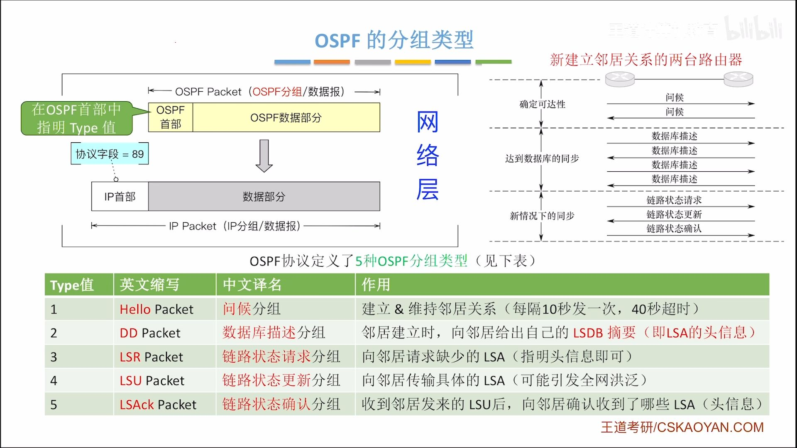
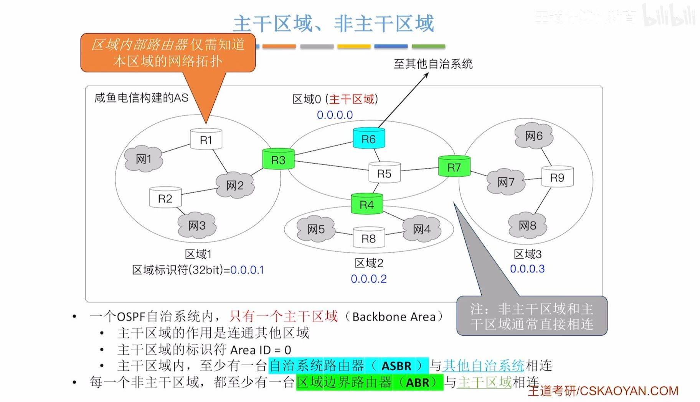
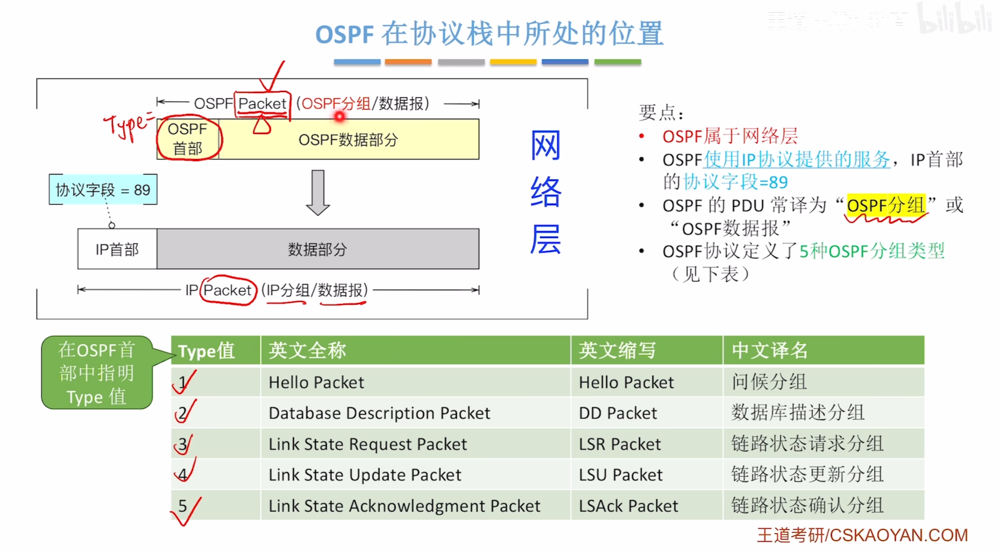

# 分层路由协议

> 梳理「分层路由协议」的核心概念、原理与工程实践要点。

将网络分为多个自治系统（AS，编号ASN）,每个AS至少有一个边界路由器连接外部，各个边界路由器之间使用相同的路由协议，每个自治系统内部独立使用路由协议

每个自治系统聚合一个或者多个CIDR地址块

1. 自治系统内部存在**内部网关协议(IGP)**
2. 各个AS之间存在**外部网关协议(EGP)**

## RIP路由协议
属于应用层，UDP 520端口号

## 转发路径的长度
使用**跳数**衡量距离
每经过一个路由器，跳数+1
**RIP最佳路径就是跳数最少的路径**
**合法的跳数不能超过15**
RIP认为跳数超过15，网络不可达
因此仅用于**小型的自治系统**
## 路由算法
使用距离-向量路由算法(bellman-ford算法)
需要获取到各个节点的跳数

## 路由表的格式
表项中需要有：
1. 目的网络(CIDR网络前缀)
2. 距离
3. 下一跳的路由器(IP地址)
例如：

| 目的网络 | 距离  | 下一跳路由器                  |
| ---- | --- | ----------------------- |
| Net0 | 1   | 外部路由(连接到外部网络的**边界路由器**) |
| Net1 | 2   | NULL                    |
| Net2 | 8   | R4                      |
| Net3 | 1   | 直接交付（直接与Net3相连）         |

## 交换信息
1. 何时交换信息：每隔一段时间（通常为30s）发送自己的路由表RIP响应报文到相邻节点路由器；同时使用**触发更新**机制，得知自身路由数据发生变化，就交换路由表数据信息给相邻的其他路由器
2. 直接和相邻路由器交换信息
3. 交换的信息为自己的路由表信息（封装在RIP响应报文中）

## 工作流程
初始化：每个路由器将与自己相邻的各个目的网络的距离初始化为1

工作信息交换流程：每隔一段时间（通常30s），每个路由器向周围路由器发送自己的路由表信息，然后交由相邻路由器进行对照（接受路由器会将收到的路由表项每个距离+1并将下一跳路由修改为发送的路由），接收的路由器对照自身的路由表，
如果网络不存在，直接添加到路由表
如果存在则：
1. 如果下一跳路由并不是发送的路由器，则保留其中**较小距离**的表项；
2. 如果下一跳路由是发送的路由器，则进行**更新最新的距离**
每当每个路由器都能够获取到所有网络之间的最短距离信息等，称为**收敛**

**特殊情况：** 如果超过了一定时间（180s）还未收到相邻的路由器的更新路由表信息，则会将相邻的路由器更改为**不可到达**（即距离设置为16）

## RIP优缺点
### 缺点

由特殊情况中如果认为不可达的网络没有其他任何路径可到达时，错误的路由会导致形成**环路**，会经过很多次迭代，直到路由信息递增到16，所有的路由才会确定不可达的网络不可达
这就是**慢收敛现象**

错误会更慢被发现并修正

**限制了网络的规模，仅能用于小型网络**
### 优点

更新的路由消息传播的快，短时间内即可将更新信息传遍所有路由器

## OSPF路由协议
属于**网络层**，使用**IP协议**提供的服务，IP首部的协议字段=89
其IP数据报的PDU称为**OSPF分组**

## 工作原理
基于**链路状态路由算法（迪杰斯特拉算法）**，需要让每一个路由器建立**整个网络的拓扑图**（带权有向图，邻接表存储）
每台路由器初始时知道与哪些节点直连以及带权路径

权值为`参考带宽(默认为100Mbps) / 接口带宽`,例如权值为2，接口带宽为50Mbps；
一段链路的两个方向权值可能不同：**直连网络->路由器方向的权值视为0**，路由器->直连网络方向的权值通常不为0；
如果到达同一个目的网络的存在多个相同代价的路径，则会将通信量分配给这些路径，实现**负载均衡**

每台路由器会将与自己直连的所有**链路状态**，通过**洪泛法**进行传播
洪泛法不可回流转发、不可重复转发相同的链路状态信息
一旦发现链路状态发生变化，将会再次洪泛，**不存在“坏消息转发慢”的现象**

**具有鉴别功能**，保证在可信赖的路由器之间交换链路状态信息

支持可变长度的子网划分和无分类编址CIDR

每个链路状态都会有一个**序号**（32位），序号越大，状态越新。

每个路由器存储路由状态信息的邻接表称为**链路状态数据库（LSDB）**
## 具体工作流程
使用迪杰斯特拉算法获取到达各个网络的所有最短路径
每个路由器借助算法得到的路径，存储OSPF路由表，**只存储到达下一跳**的具体信息，类似上面的RIP协议的路由表
一旦发生网络拓扑变化，每个路由器的LSDB都会变化，立即引起洪泛，再次运行算法构造新的路由表

## 区域划分
在一个自治系统进行区域划分，洪泛的范围局限在各个区域内部，用于减少LSDB和洪泛、算法的开销，提高效率
主干区域用于连同其他区域，至少有一台**自治系统边界路由器（ASBR）** 与其他自治系统相连
每一个非主干区域，都至少有一台**区域边界路由器(ABR)** 与主干区域连接

LSDB： 链路状态数据库
LSI： 链路状态信息
LSA： 链路状态通告

## 分组类型

