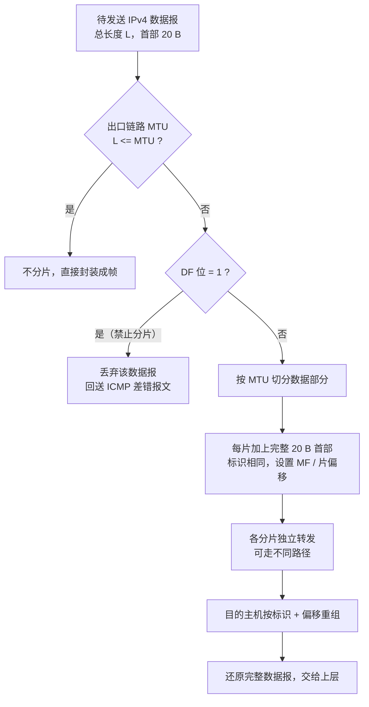

# IPv4 分组（数据报）的格式与分片

> 概述：本篇解决「IPv4 首部每个字段管什么、数据报超过 MTU 时怎么分片、片偏移与长度怎么算」三个问题。主线：**首部字段 → 分片机制 → 分片计算 → 易错点**。

---

## 一、核心概念

### 1. 首部结构

一句话：IPv4 首部 = **固定 20 B + 可选字段（最多 40 B）**，因此首部长度范围是 **20–60 B**；其后才是数据部分。

| 字段 | 长度 | 作用 / 考点 |
| --- | --- | --- |
| 版本 | 4 bit | IP 版本号，IPv4 为 4 |
| **首部长度** | 4 bit | **以 4 B 为单位**，最小 5（=20 B），最大 15（=60 B） |
| 区分服务 | 8 bit | 服务类型 / QoS，一般考试不深究 |
| **总长度** | 16 bit | **以 1 B 为单位**，= 首部 + 数据，最大 65535 B |
| **标识** | 16 bit | 同一数据报的所有分片**该字段相同**，用于重组识别 |
| **标志** | 3 bit | 保留位 + **DF（禁止分片）** + **MF（还有分片）** |
| **片偏移** | 13 bit | **以 8 B 为单位**，表示该片数据在原始数据部分的起始位置 |
| 生存时间 TTL | 8 bit | 每经过一台路由器减 1，减到 0 丢弃，防止分组在环路中无限转发 |
| 协议 | 8 bit | 上层协议：**ICMP=1，TCP=6，UDP=17** |
| 首部校验和 | 16 bit | **只校验首部**，不校验数据；每跳因 TTL 改变需重新计算 |
| 源 IP 地址 | 32 bit | 发送方接口地址 |
| 目的 IP 地址 | 32 bit | 接收方接口地址 |
| 可选字段 | 0–40 B | 安全、时间戳、记录路由等，实际很少使用 |
| 填充 | 可变 | 用 0 补齐，保证首部是 **4 B 的整数倍** |

![[mx-img-lktpn8ihrlet22tpphdzfs7x-pt5m50_91s-jh77zf.jpg|4.2.1 IPv4分组（咸鱼版） - 王道计算机考研 计算机网络 - 05:50|416]] [05:50](https://www.bilibili.com/video/BV19E411D78Q?p=46&t=350.911438#t=05:50.91)

> [!note] 三个"单位"必须记牢
> - **首部长度 ×4 B**：字段值 5 表示 20 B。
> - **总长度 ×1 B**：直接就是字节数，注意它包含首部。
> - **片偏移 ×8 B**：这个单位原笔记提到了，但最容易被漏算。
>
> 另外，首部长度最小为 5 是因为固定部分 20 B = 5 × 4 B；有可选字段时才会大于 5。

### 2. 三个与分片直接相关的字段

- **标识（Identification）**：发送方每产生一个数据报就加 1。分片时所有分片复制同一个标识值，目的主机据此判断"这些片属于同一个原始数据报"。
- **标志（Flags）**：
  - 最低位 **MF（More Fragment）= 1** 表示后面还有分片；最后一片 **MF = 0**。
  - 中间位 **DF（Don't Fragment）= 1** 表示不允许分片；若此时长度超过 MTU，路由器丢弃该分组并返回 ICMP 差错（类型 3、代码 4）。
- **片偏移（Fragment Offset）**：以 **8 B** 为单位，值 = 该片数据部分第一个字节在原始数据部分中的偏移 ÷ 8。

---

## 二、原理 / 流程

### 1. 为什么要分片

链路层能承载的最大数据长度称为 **MTU（Maximum Transmission Unit）**，以太网典型值为 **1500 B**。当 IP 数据报的**总长度（首部 + 数据）**超过出口链路的 MTU 时，就必须分片。

### 2. 分片规则

关键规则：

1. **每片都有完整的 IP 首部**（通常 20 B），因此每片可携带的数据最多为 `MTU − 20`。
2. **除最后一片外，每片数据长度必须是 8 B 的整数倍**，否则片偏移字段无法用整数表示。
3. **片偏移 = 该片数据起点的字节偏移 ÷ 8**；最后一片 MF = 0，其余 MF = 1。
4. **每片的总长度字段各自填写**：`该片总长度 = 首部长度 + 该片数据长度`。
5. **分片可以发生在源主机或路径上的任何一台路由器**；但**重组只发生在目的主机**，中间路由器不重组。
6. 任一分片丢失或超时未到齐，**整个原始数据报被丢弃**，IP 层不负责重传（由上层 TCP 处理）。

![[mx-img-lktpn8ihrlet22tpphdzfs7x-pt13m30_33s-1nkoywd.jpg|4.2.1 IPv4分组（咸鱼版） - 王道计算机考研 计算机网络 - 13:30|415]] [13:30](https://www.bilibili.com/video/BV19E411D78Q?p=46&t=810.328046#t=13:30.33)

### 3. 重组依据

目的主机用 **（源 IP，目的 IP，协议，标识）** 四元组识别同一原始数据报的分片，再按片偏移排序拼接。因此：

- 标识只有 16 bit，不同数据报可能重复，必须结合源 / 目的 IP 等字段区分。
- 重组需要缓存，且要设置超时定时器，防止资源被半成品分片长期占用。

---

## 三、计算示例

**题目**：一个 IPv4 数据报总长 **4000 B**（首部 20 B，数据 3980 B），经过 **MTU = 1500 B** 的链路，求分片结果。

**求解**：

- 每片最大数据 = `MTU − 首部 = 1500 − 20 = 1480 B`。
- `3980 = 1480 + 1480 + 1020`，共 3 片。
- 前两片数据长 1480 B（是 8 的整数倍），最后一片 1020 B（最后一片允许不是 8 的倍数）。

| 分片 | 数据字节范围（原始数据内） | 数据长度 | 片偏移字段值 | MF | 总长度字段值 |
| --- | --- | --- | --- | --- | --- |
| 第 1 片 | 0 – 1479 | 1480 B | `0 ÷ 8 = 0` | 1 | 20 + 1480 = **1500** |
| 第 2 片 | 1480 – 2959 | 1480 B | `1480 ÷ 8 = 185` | 1 | 20 + 1480 = **1500** |
| 第 3 片 | 2960 – 3979 | 1020 B | `2960 ÷ 8 = 370` | 0 | 20 + 1020 = **1040** |

> [!note] 验算技巧
> - 第 2 片的偏移 = 第 1 片数据长度 ÷ 8 = 185，而不是 1480。
> - 第 3 片偏移 = 前两片数据长度之和 ÷ 8 = 2960 ÷ 8 = 370。
> - 三片总长度之和 = 1500 + 1500 + 1040 = **4040 B**，比原始 4000 B 多出的 40 B 正是**额外两片的首部开销**——分片是有代价的。

---

## 四、易错点 / 注意事项

- ==🔴== **三个单位别混**：首部长度 ×4 B、总长度 ×1 B、片偏移 ×8 B。
- ==🔴== **总长度包含首部**；同理，MTU 比较的是"首部 + 数据"的总长度，不是只看数据部分。
- ==🔴== **除最后一片外，每片数据长度必须是 8 B 的整数倍**；最后一片不受此限。
- ==🔴== **片偏移的基准是原始"数据部分"的起点**，不包含首部。
- ==🔴== **DF 与 MF 方向相反**：DF=1 禁止分片；MF=1 表示还有后续分片，最后一片 MF=0。
- ==🔴== **只有目的主机重组分片**；分片却可以由源主机或任意中间路由器完成。
- **TTL 是跳数不是时间**：每经一台路由器减 1，为 0 时丢弃并回送 ICMP 超时报文。
- **首部校验和只校验首部**；因为 TTL 每跳变化，路由器转发时需重新计算首部校验和。
- **任一一片丢失，整个数据报作废**，IP 层不重传，靠 TCP 超时重传恢复。
- **DF=1 且超 MTU 时路由器丢弃并回 ICMP 差错（类型 3 代码 4）**，这也是路径 MTU 发现的原理。
- **IPv4 首部最长 60 B**（可选字段最多 40 B），填充的作用是保证首部按 4 B 对齐。
- 分片增加首部开销、降低转发效率；现代网络中常通过 **路径 MTU 发现**尽量避免分片。

---

## 五、小结

- IPv4 首部固定 **20 B**，最长 **60 B**；总长度最大 65535 B。
- 与分片相关的四个字段：**标识（同源识别）、DF（禁止分片）、MF（还有分片）、片偏移（×8 B）**。
- 分片规则：每片带完整首部；除最后一片外数据长度为 8 B 倍数；**分片可在任意节点，重组只在目的主机**。
- 计算通式：`每片最大数据 = MTU − 首部长度`；`片偏移 = 原始数据字节偏移 ÷ 8`；`该片总长度 = 首部 + 数据`。
- 分片有开销、丢失即全废，所以实际网络倾向用 **路径 MTU 发现**避免分片。

---

## 相关笔记

- [[IP地址]] —— 地址结构、子网划分、NAT / DHCP / ARP
- [[计算机网络分层]] —— 网络层与数据链路层的职责划分
- [[计算机网络的组成和功能、交换技术]] —— 分组转发与交换设备
- [[README]] —— 仓库主页 / 知识库总览

---

- **知识库总览**：[[README]]
- **仓库主页**：[[README]]
