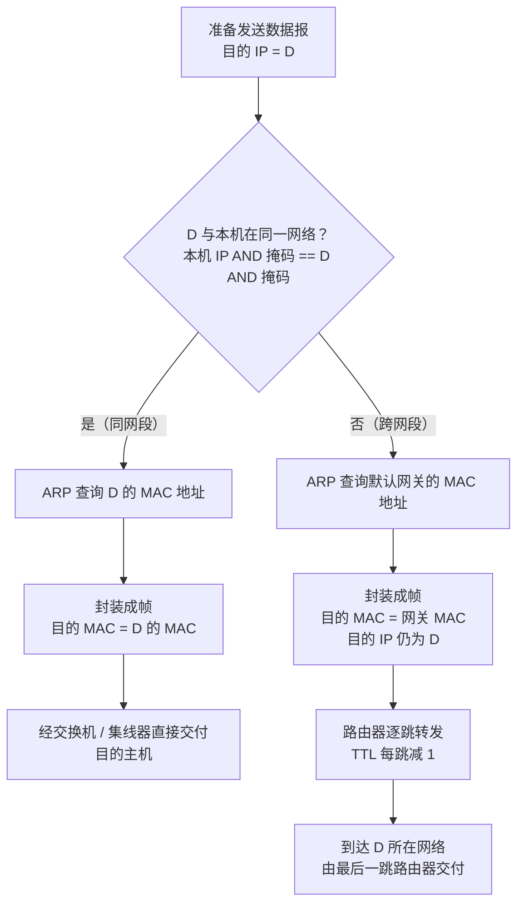

# IP 地址、子网划分与 NAT

> 概述：本篇解决「IP 地址怎么编、主机怎么用它把数据发出去、地址不够用怎么办」三个问题。主线：**IPv4 地址结构与特殊地址 → 数据发送流程（同网段 / 跨网段）→ 子网划分与 CIDR 路由聚合 → DHCP / NAT / ARP 支撑协议**。

---

## 一、核心概念

### 1. IPv4 地址的结构

一句话：IPv4 地址是 **32 bit 的逻辑地址**，由「网络号 + 主机号」两部分组成，点分十进制只是为了便于阅读。

- 32 bit = 4 组 × 8 bit，每组取值 0–255，写成 `a.b.c.d`。
- **网络号**标识主机所在网络，**主机号**标识网络内的具体接口。
- **IP 地址是分配给"网络接口"的，不是分配给"主机"的**：一台路由器有多个接口，因此有多个 IP 地址。
- 同一网络内：网络号相同、主机号不同。

分类地址（classful，历史方案，现代互联网已由 CIDR 取代，但考试仍考）：

| 类别 | 首位模式 | 网络号位数 | 第一字节范围 | 用途 |
| --- | --- | --- | --- | --- |
| A 类 | 0 | 8 | 1–126 | 单播，超大型网络 |
| B 类 | 10 | 16 | 128–191 | 单播，中型网络 |
| C 类 | 110 | 24 | 192–223 | 单播，小型网络 |
| D 类 | 1110 | — | 224–239 | 多播（组播） |
| E 类 | 1111 | — | 240–255 | 保留 |

> [!note] 两个容易记错的边界
> - `0.x.x.x` 与 `127.x.x.x` 都不属于可分配的 A 类地址：前者保留，后者是环回地址。
> - A/B/C 类中**网络号全 0、全 1 不可用**（历史规定），所以 A 类可分配网络号是 1–126。

### 2. 特殊 IP 地址

判定特殊地址看的是**二进制位**（网络号 / 主机号是否为全 0 或全 1），不是十进制位：

| 网络号 | 主机号 | 作源地址 | 作目的地址 | 含义 |
| --- | --- | --- | --- | --- |
| Y | 全 0 | ✗ | ✗ | 表示**整个网络本身**，只能出现在路由表 / 转发表中 |
| Y | 全 1 | ✗ | ✓ | 向网络号为 Y 的网络**广播** IP 分组 |
| 0 | Y | ✓ | ✗ | 表示**本网络中主机号为 Y 的主机** |
| 全 0 | 全 0 | ✓ | ✗ | **本网络上的本主机**，DHCP 请求时用作源地址 |
| 全 1 | 全 1 | ✗ | ✓ | 向**本网络**广播（`255.255.255.255`），不被路由器转发 |
| 127 | 非全 0 / 非全 1 | ✓ | ✓ | **环回自检地址**，表示主机本身，用于本地软件环回测试 |

![[Pasted image 20261017161417.png]]

> [!warning] 纠正常见误解
> - **不是 `127.0.0.0` 表示主机本身**，而是 `127.0.0.0/8` 整个网段都用于环回，日常使用 `127.0.0.1`。
> - **`0.0.0.0` 不是"该网络本身"**：作为源地址表示"本网络上的本主机"（DHCP 场景）；作为目的地址出现在路由表中时，表示默认路由 `0.0.0.0/0`。
> - 主机号全 0 的地址（如 `192.168.1.0`）是**网络地址**，主机号全 1 的（如 `192.168.1.255`）是**广播地址**，二者都不能分配给主机。

私有地址（只能在内网使用，不能出现在公网路由中）：

| 地址块 | 前缀 | 规模 |
| --- | --- | --- |
| `10.0.0.0` – `10.255.255.255` | `10.0.0.0/8` | 1 个 A 类网 |
| `172.16.0.0` – `172.31.255.255` | `172.16.0.0/12` | 16 个 B 类网 |
| `192.168.0.0` – `192.168.255.255` | `192.168.0.0/16` | 256 个 C 类网 |
| `169.254.0.0/16` | 链路本地地址 | 未获取到 DHCP 地址时自动配置（APIPA） |

### 3. 子网掩码

一句话：**子网掩码用于从 IP 地址中"切"出网络前缀**，与 IP 做按位与运算即得网络地址。

- 掩码中连续的 1 对应网络前缀，0 对应主机号。
- `/n` 表示前 n 位为 1，如 `167.3.192.3/24` 的掩码是 `255.255.255.0`。
- 网络地址 = `IP AND 掩码`；广播地址 = 主机号全置 1。
- 可用主机数 = **2^n − 2**（n 为主机号位数，去掉网络地址和广播地址）。

---

## 二、原理 / 流程

### 1. 主机发送 IP 数据报的完整流程

主机接入网络时需要配置四样东西：**IP 地址、子网掩码、默认网关、DNS 服务器**。发送数据时，主机先用「本机 IP AND 掩码」与「目的 IP AND 掩码」比较：



> [!warning] 纠正常见误解
> 判断"是否同网段"比较的是**目的 IP 与本机 IP 的网络前缀**（通过子网掩码计算），**不是比较两台的默认网关地址**。同一网段的主机通常配置同一个网关，但"网关相同"不是判断依据。

### 2. ARP 协议：IP → MAC

- **ARP 请求**：广播发送「谁的 IP 是 X？请告诉我你的 MAC」。
- **ARP 应答**：目标主机**单播**回复自己的 MAC。
- 结果存入 **ARP 高速缓存**（有老化时间），避免每次都广播。
- 跨网段通信时，ARP 解析的是**默认网关的 MAC**，目的 IP 始终是最终主机——IP 负责端到端，MAC 负责逐链路。

### 3. DHCP：自动获取 IP

主机刚接入网络时没有 IP，DHCP 通过 4 个报文完成租约分配（客户端 UDP 68，服务器 UDP 67）：

| 步骤 | 报文 | 方向 | 说明 |
| --- | --- | --- | --- |
| 1 | **Discover** | 客户端 → 广播 | 源 `0.0.0.0`，目的 `255.255.255.255`，寻找 DHCP 服务器 |
| 2 | **Offer** | 服务器 → 客户端 | 提供一个可用 IP 及租期 |
| 3 | **Request** | 客户端 → 广播 | 正式请求使用该 IP（同时告知其他服务器） |
| 4 | **ACK** | 服务器 → 客户端 | 确认分配，主机开始使用该地址 |

> [!note] 为什么必须用广播
> 主机此时还没有 IP，无法被单播寻址；其源地址是 `0.0.0.0`，目的地址是 `255.255.255.255`——这正是"全 0 / 全 1"特殊地址的典型用途。

### 4. NAT：网络地址转换

一句话：NAT 让**私有地址在内网使用、在出口处换成公有地址**，从而缓解 IPv4 地址枯竭。

- 基本 NAT：私有 IP ↔ 公有 IP 一对一转换。
- **NAPT（端口多路复用）**：同时转换 **IP + 端口**，让多台内网主机共用一个公网 IP，是家用路由器的实际做法。
- 路由器维护**转换表**：`(内网 IP, 内网端口) ↔ (公网 IP, 公网端口)`。

| 优点 | 缺点 |
| --- | --- |
| 节省公网地址 | 破坏端到端透明性，外网无法主动访问内网主机 |
| 隐藏内网拓扑，有一定安全性 | 部分协议（如 FTP、SIP）需 ALG 特殊处理 |

### 5. 子网划分与 CIDR

#### （1）子网划分

从**主机号**中借 k 位作为**子网号**，IP 地址变为 `<网络号, 子网号, 主机号>` 三级结构，对外仍表现为一个网络。

- 借 k 位 → 最多划分 **2^k** 个子网（全 0 / 全 1 子网是否可用视教材与设备而定，现代设备支持）。
- 剩余 n 位主机号 → 每个子网最多 **2^n − 2** 台主机。
- 子网掩码 = 原掩码 + 借来的 k 个 1。

#### （2）变长子网划分（VLSM）

不同子网按实际需求使用不同的前缀长度，避免地址浪费：

```text
128.14.32.128/28   → 16 个地址，可用 14 台主机
128.14.32.144/29   → 8 个地址，可用 6 台主机
128.14.32.152/30   → 4 个地址，可用 2 台主机
```

划分技巧：把所有子网看作一棵**二叉前缀树（Trie，左 0 右 1）的叶子**，而不是"哈夫曼树"——哈夫曼树按权值合并，这里只按**前缀逐位分裂**。约束是：

- 每个叶子（子网）的网络前缀**互不包含**，否则地址会重叠。
- 每个子网至少保留 **2 位主机号**（网络地址 + 广播地址）。因此若原主机号为 n 位，最多可借 **n − 2** 位，树高最多 **n − 2**。
- 例外：点对点链路可用 `/31`（RFC 3021，两个地址都可作主机），单主机可用 `/32`。

#### （3）路由聚合（构成超网）

若多条路由表项**下一跳接口相同**、且网络前缀有公共部分，可合并为一条更短前缀的路由，减小路由表规模：

| 目的网络 | 下一跳 |
| --- | --- |
| 128.144.32.128/28 | G1 |
| 128.144.32.144/29 | G1 |
| 128.144.32.152/30 | G1 |
| 0.0.0.0/0（默认路由） | G0 |

聚合后：

| 目的网络 | 下一跳 |
| --- | --- |
| **128.144.32.128/27** | G1 |
| 0.0.0.0/0 | G0 |

- `/27` 覆盖 `128.144.32.128`–`128.144.32.159`，其中 **`.156`–`.159` 是聚合引入的无效地址**（原表项并未精确覆盖）。
- 转发时使用**最长前缀匹配**：目的地址同时匹配多条路由时，选前缀最长的那条；默认路由 `0.0.0.0/0` 前缀最短，只作兜底。
- 聚合只能合并**前缀连续、可被同一条更短前缀完整覆盖**的表项；若某个表项下一跳不同，就不能合并。

---

## 三、计算示例

**题目**：`167.3.192.36/26`，求网络地址、广播地址、可用主机范围。

1. `/26` → 掩码 `255.255.255.192`，块大小 `256 − 192 = 64`。
2. 36 落在 `0–63` 块内 → 网络地址 `167.3.192.0`。
3. 广播地址 = 下一块起点 − 1 = `167.3.192.63`。
4. 可用主机：`167.3.192.1` – `167.3.192.62`，共 `2^6 − 2 = 62` 台。

**变长子网划分示例**：`192.168.1.0/24` 分配给 3 个部门（分别需要 100、50、20 台主机）。

| 部门 | 需求主机 | 主机位 | 前缀 | 子网 |
| --- | --- | --- | --- | --- |
| A | 100 | 7（2^7−2 = 126） | /25 | `192.168.1.0/25`（.0–.127） |
| B | 50 | 6（2^6−2 = 62） | /26 | `192.168.1.128/26`（.128–.191） |
| C | 20 | 5（2^5−2 = 30） | /27 | `192.168.1.192/27`（.192–.223） |

剩余 `192.168.1.224/27` 可留作扩展。

---

## 四、易错点 / 注意事项

- ==🔴== **判断是否同网段，比较的是目的 IP 与本机 IP 的网络前缀，不是默认网关地址**。
- ==🔴== **`127.0.0.0/8` 是环回网段**，不是"`127.0.0.0` 表示主机本身"；日常使用 `127.0.0.1`。
- ==🔴== **`0.0.0.0` 有两种语境**：作源地址 = 本网络上的本主机（DHCP）；作路由表项 = 默认路由。它不是"网络本身"。
- ==🔴== 网络地址（主机号全 0）和广播地址（主机号全 1）**不能分配给主机**，算主机数要减 2。
- ==🔴== `167.3.192.3/24` 中的 `/24` 是**前缀长度**，等价于掩码 `255.255.255.0`，不是"第 24 位"。
- **子网划分借位后树高最多 n−2**，不是 n−1（至少给主机留 2 位）；`/31`、`/32` 是特殊例外。
- **路由聚合会引入无效地址**，这些地址可能被转发到该接口（可再用更具体路由或防火墙处理）。
- **最长前缀匹配**优先于默认路由；默认路由只在无其他匹配时生效。
- **ARP 跨网段解析的是网关 MAC**，不是目的主机的 MAC。
- **NAT 下外网不能主动发起连接**，需要做端口映射才能让内网服务被访问。
- 分类地址是历史概念，分析现代网络时用 **CIDR**，不要套用 A/B/C 类默认掩码。

---

## 五、小结

- IPv4 地址 = **32 bit，网络号 + 主机号**；A/B/C 类单播、D 类多播、E 类保留。
- 特殊地址记两条主线：**全 0 = 本网络 / 本主机，全 1 = 广播，127/8 = 环回**；私有地址为 `10/8`、`172.16/12`、`192.168/16`。
- 发送流程：**同网段直接 ARP 目的主机；跨网段 ARP 默认网关，由路由器逐跳转发**。
- 子网划分：**借位 → 掩码变长 → 主机数 2^n − 2**；VLSM 用前缀树思想按需分配。
- 路由聚合：**同下一跳 + 前缀可合并 → 超网**，转发按**最长前缀匹配**。
- 配套协议：**DHCP 自动分配、NAT 缓解地址枯竭、ARP 完成 IP→MAC 映射**。

---

## 相关笔记

- [[IPv4分组（数据报）]] —— 首部字段与分片计算
- [[计算机网络分层]] —— IP 所在网络层的位置与各层职责
- [[计算机网络的组成和功能、交换技术]] —— 路由器、交换机的转发基础
- [[计算机网络分类以及网络性能指标]] —— 网络分类与性能指标
- [[README]] —— 仓库主页 / 知识库总览

---

- **知识库总览**：[[README]]
- **仓库主页**：[[README]]
