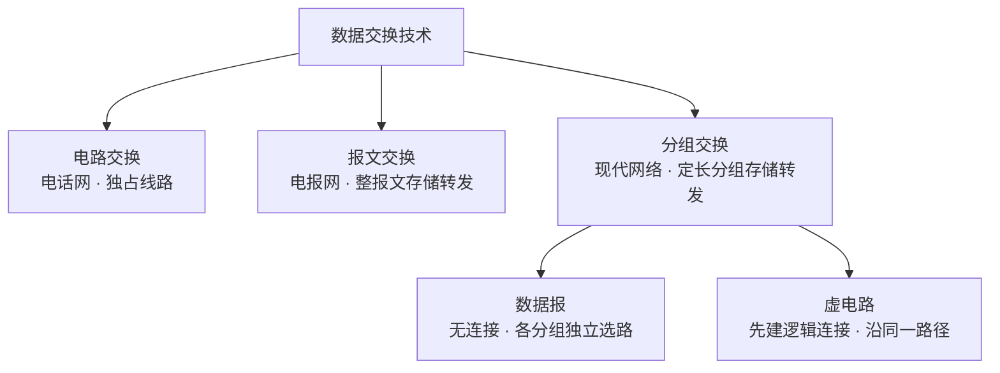

# 计算机网络的组成、功能与交换技术

> 概述：本篇回答「计算机网络是什么」这一底层问题，主线为 **定义 → 三种视角看组成 → 六大功能 → 数据交换技术（电路 / 报文 / 分组）**，为后续分层模型打基础。

---

## 一、什么是计算机网络

**定义**：计算机网络是将**分散的、具有独立功能的多个计算机系统**，通过**通信设备与通信链路**连接起来，由**功能完善的软件**实现**资源共享**与**信息传递**的系统。

三个关键词：

- **分散 + 独立功能**：各主机是**自治**的，一台崩溃不影响其他主机。
- **连接**：由通信设备（路由器、交换机）与通信链路（双绞线、光纤、无线）物理 / 逻辑相连。
- **共享 + 传递**：最终目的是**资源共享**与**数据通信**。

---

## 二、计算机网络的组成

同一张网，可以从三个视角去看：

### 1. 从「组成部分」看

| 组成 | 内容 | 例子 |
| --- | --- | --- |
| 硬件 | 主机、通信设备、通信链路 | 电脑、路由器、光纤 |
| 软件 | 方便用户使用、支撑通信的应用与系统软件 | 浏览器、客户端、协议栈 |
| 协议 | 通信双方必须共同遵守的规则 | TCP/IP、HTTP |

> [!note] 协议由软件和硬件共同实现
> 例如**网络适配器（网卡）**：==🟠把主机数据发送到网络上、并接收来自网络的数据==，即硬件 + 驱动 / 协议软件协同完成协议功能。

### 2. 从「工作方式」看

- **核心部分**：由大量**路由器 / 交换机**组成，为边缘部分**提供服务**。
- **边缘部分**：由连接到网络上的**主机**组成，**直接为用户服务**（运行各种网络应用）。

### 3. 从「逻辑功能」看

| 子网 | 组成 | 职责 |
| --- | --- | --- |
| **资源子网** | 连接到网络的主机（硬件、软件、数据资源） | 为用户提供可共享的硬件、软件、信息资源 |
| **通信子网** | 通信链路 + 通信设备 + 协议 | 负责信息传输 |

> [!warning] 易错边界
> **主机底层的硬件与软件、主机内部的网络适配器、底层通信协议**，都属于**通信子网**的范畴；而「主机」整体（其上承载的资源）算**资源子网**。

---

## 三、计算机网络的功能

1. **数据通信**——最基本的功能。
2. **资源共享**——硬件 / 软件 / 数据资源三类共享。
3. **分布式处理**——一个大型任务由多台设备**分工协作**完成（如分布式计算、DNS 解析）。
4. **提高可靠性**——网络中计算机**互为备份**，一台故障可由其他主机接管。
5. **负载均衡**——多台计算机**均衡分担**繁重任务。
6. **满足社会 / 生活需求**——如远程办公、在线教育、社交娱乐。

> [!note] 分布式处理 ≠ 负载均衡
> **分布式处理**强调「任务被**拆分**、多机**协作**」；**负载均衡**强调「任务被**均衡分配**以减轻单机压力」。二者常一起出现，但侧重点不同。

---

## 四、数据交换技术

「交换」= 如何把数据从源经中间节点送到目的。共经历了三代：

### 1. 电路交换——电话网络

通信前先**动态分配一条物理线路**，通信全程**独占**该线路。

```
1. 建立连接（占用沿途资源）
2. 通信（资源被通信双方独占）
3. 释放连接
```

| 优点 | 缺点 |
| --- | --- |
| 时延小、实时性强 | 建立 / 释放连接有额外时间开销 |
| 数据**有序**到达、无冲突 | 线路被**独占**，利用率低 |
| 传输速率较快 | 分配灵活性差，**不支持一对多 / 多对多** |
|  | 交换节点**不做差错控制**，无法发现数据错误 |

> 由于网络数据具有**突发性**，电路交换**不适合计算机网络**，但很适合**语音（电话）**这类连续、恒速的业务。

### 2. 报文交换——电报网络

采用**存储转发**：发送方把**整个报文**先全部传给中间节点，中间节点存储后再转发给下一节点，直至目的。

| 优点 | 缺点 |
| --- | --- |
| 通信前**无需建立连接** | 报文**不定长**，不利于存储转发管理 |
| 线路可**灵活分配、共享** | 长报文**存储转发开销大** |
| **支持差错控制** | 长报文传输易出错，**重传代价大** |
| 支持一对多 | 转发时延较大 |

### 3. 分组交换——现代计算机网络

在报文交换基础上，把**不定长的报文**拆成若干**定长的「分组」（packet）**，分组 = **首部 + 数据**；首部携带源地址、目的地址、分组号等控制信息。

> **路由器**就是典型的分组交换机。

| 优点 | 缺点 |
| --- | --- |
| 分组短、不易出错，**出错重传代价小** | 需要额外**控制信息（首部）开销** |
| 便于**存储、转发**，转发开销小 | 存储转发带来时延 |
| 线路利用率高、传输快 | 可能出现**失序、丢失**，需重排 / 重传 |

### 4. 虚电路交换——分组 + 电路

在**分组交换**基础上引入**电路交换**的思想：通信前先建立一条**逻辑连接（虚电路）**，之后所有分组**沿同一路径、按序**传输。它是分组交换的一种实现方式（另一种是**数据报**方式）。

### 5. 三种交换技术对比

| 对比项 | 电路交换 | 报文交换 | 分组交换 |
| --- | --- | --- | --- |
| 是否建立连接 | 需要 | 不需要 | 数据报：不需要 / 虚电路：需要 |
| 是否存储转发 | 否 | 是（整报文） | 是（小分组） |
| 线路利用率 | 低 | 高 | 高 |
| 传输时延 | 小且稳定 | 大 | 较小 |
| 差错控制 | 无 | 有 | 有 |
| 数据顺序 | 有序 | 有序 | 可能失序 |
| 典型应用 | 电话网 | 电报网 | 现代计算机网络 |



---

## 五、易错点 / 注意事项

- **分组定长、报文不定长**——这是分组交换相对报文交换的关键改进。
- **电路交换**不能做差错控制、不支持一对多，**不适合计算机网络**（但适合语音）。
- **通信子网**包含主机的底层硬件 / 软件、网卡、底层协议——别把主机整体都划进通信子网。
- 默认的**分组交换是「数据报」方式**（无连接）；**虚电路**才需要先建立连接。
- **分布式处理**（任务拆分协作）≠ **负载均衡**（任务均衡分配）。
- 「数据通信」是计算机网络**最基本**的功能。

---

## 六、小结

- 计算机网络 = **自治主机 + 通信设施 + 协议**，实现**资源共享**与**信息传递**。
- 组成看三面：**组成部分（硬 / 软 / 协议）· 工作方式（核心 / 边缘）· 逻辑功能（资源子网 / 通信子网）**。
- 六大功能：数据通信、资源共享、分布式处理、提高可靠性、负载均衡、满足社会需求。
- 交换技术三代：**电路交换（专线独占）→ 报文交换（整报文存储转发）→ 分组交换（定长分组存储转发）**；虚电路是分组交换的一种连接式实现。

---

## 相关笔记

- [[计算机网络分类以及网络性能指标]] —— 网络的分类与性能指标（速率 / 带宽 / 时延 / RTT）
- [[README]] —— 仓库主页 / 知识库总览

---

- **知识库总览**：[[README]]
- **仓库主页**：[[README]]
