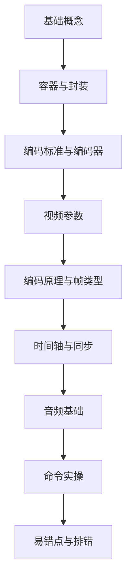

# 音视频 ffmpeg 知识地图

> **概述**：这是「音视频 ffmpeg」系列的总入口。先读 [[基础概念]] 建立整体心智模型，再按需进入容器、编码、视频参数、时间轴、音频和命令笔记。
>
> **原则**：概念与命令分离；先理解「是什么、为什么」，再查「怎么写」。

---

## 学习路线

> [!tip] 使用建议
> - 第一次学习：按上图顺序通读。
> - 查命令：直接跳到 [[命令实操]]。
> - 遇到报错：先看 [[易错点与排错]]，再回到对应概念笔记。
> - 需要快速回忆：看下面的「核心概念速查」。

---

## 笔记索引

| 笔记 | 定位 | 关键内容 |
| --- | --- | --- |
| [[基础概念]] | 总览与入口 | ffmpeg 是什么、工具链、处理管线、流、三个核心概念 |
| [[容器与封装]] | 容器层 | MP4/MKV/TS/FLV、兼容性、muxer/demuxer、重封装 vs 转码、字幕 |
| [[编码标准与编码器]] | 编码层 | H.264/H.265/AV1/VP9、编码器命名、Profile/Level、preset、画质指标 |
| [[视频参数]] | 画面层 | 分辨率、帧率、宽高比、扫描、色深、像素格式、色彩、码率 |
| [[编码原理与帧类型]] | 压缩层 | 冗余、I/P/B 帧、IDR、GOP、seek 与抽帧 |
| [[时间轴与同步]] | 时间层 | PTS、DTS、time_base、时间戳坑、音画同步 |
| [[音频基础]] | 音频层 | 采样率、位深、声道、PCM 码率、音频编码器、响度 |
| [[命令实操]] | 实践层 | 命令结构、ffprobe、转码、重封装、裁剪、抽帧、字幕、推流、硬件加速 |
| [[易错点与排错]] | 排错层 | 常见坑、报错速查、排错顺序 |

---

## 核心概念速查

| 问题 | 一句话答案 | 详见 |
| --- | --- | --- |
| ffmpeg 是什么？ | 音视频处理工具与框架，不是编码标准 | [[基础概念#一、ffmpeg 是什么]] |
| 容器、编码标准、编码器怎么区分？ | 盒子、规则、执行规则的程序 | [[基础概念#五、三个概念不要混]] |
| 重封装和转码有什么区别？ | 重封装只换盒子，转码重新压缩 | [[容器与封装#五、重封装 vs 转码]] |
| MP4 和 MKV 怎么选？ | 要兼容选 MP4，要包容选 MKV | [[容器与封装#二、常见容器对比]] |
| H.264 和 H.265 怎么选？ | 兼容选 H.264，省码率选 H.265 | [[编码标准与编码器#二、常见视频编码标准]] |
| 分辨率、帧率、码率是什么关系？ | 共同决定画质与体积，码率不是越高越好 | [[视频参数#七、码率与码率控制]] |
| 为什么 YUV 4:2:0 这么常见？ | 人眼对色度不敏感，比 4:4:4 省一半数据 | [[视频参数#六、像素格式与色彩]] |
| I/P/B 帧和 GOP 是什么？ | I 独立、P 参考前、B 参考前后；GOP 是关键帧间隔 | [[编码原理与帧类型]] |
| PTS 和 DTS 有什么区别？ | PTS 管显示，DTS 管解码 | [[时间轴与同步#一、为什么需要 PTS/DTS]] |
| PCM 码率怎么算？ | 采样率 × 位深 × 声道数 | [[音频基础#四、PCM 码率]] |
| 命令从哪里开始看？ | 先看命令结构，再查常用命令 | [[命令实操#一、命令结构与选项作用域]] |
| 报错先看什么？ | 先 `ffprobe` 看流和参数 | [[易错点与排错#六、排错顺序]] |

---

## 相关

- [[README]] —— 知识库总览
- [FFmpeg 官方文档](https://ffmpeg.org/documentation.html)
- [FFmpeg Wiki: Encode/H.264](https://trac.ffmpeg.org/wiki/Encode/H.264)
- [FFmpeg Wiki: Encode/H.265](https://trac.ffmpeg.org/wiki/Encode/H.265)
- [FFmpeg Filters](https://ffmpeg.org/ffmpeg-filters.html)
