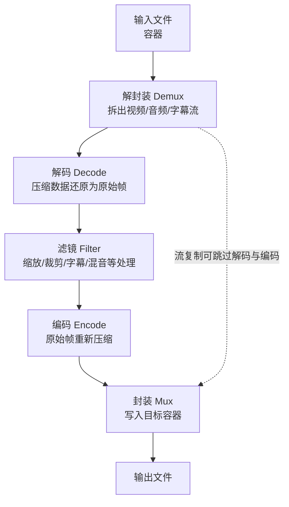

# ffmpeg 基础概念（总览）

> **概述**：这是「音视频 ffmpeg」系列的入口笔记，先建立整体心智模型：ffmpeg 是什么、由哪些工具组成、一条媒体数据在管线中如何流动、什么是流，以及容器 / 编码标准 / 编码器三者的区别。
>
> **用法**：概念细节拆到各专题笔记，命令统一放在 [[命令实操]]。建议按 [[音视频ffmpeg/_MOC|知识地图]] 的学习顺序阅读。

> [!summary]- 目录
> - [[#一、ffmpeg 是什么]]
> - [[#二、工具链]]
> - [[#三、处理管线]]
> - [[#四、流（Stream）]]
> - [[#五、三个概念不要混]]
> - [[#六、本系列学习路线]]
> - [[#七、核心结论速记]]
> - [[#相关笔记]]

---

## 一、ffmpeg 是什么

> **ffmpeg 是一套开源的音视频处理工具与框架，不是编码标准，也不是某一个编码器。**
>
> 它负责把音视频从「一种容器 + 一种编码」搬运成「另一种容器 + 另一种编码」，中间可以解码、加滤镜、重新编码、再封装。

学习 ffmpeg 最容易混淆的地方，是把「容器」「编码标准」「编码器」当成同一件事。正确的拆分方式见 [[#五、三个概念不要混]]，细节分别放在 [[容器与封装]] 和 [[编码标准与编码器]]。

---

## 二、工具链

| 工具 | 作用 |
| --- | --- |
| `ffmpeg` | 转码、转封装、剪辑、滤镜、推流 |
| `ffprobe` | 分析媒体信息：流、编码、分辨率、帧率、码率、时间基 |
| `ffplay` | 极简播放器，用于快速验证输出 |
| `libav*` 库 | 二次开发用的底层库：`libavformat` / `libavcodec` / `libavfilter` / `libswscale` / `libswresample` |

- `libavformat`：封装与解封装（容器）。
- `libavcodec`：编解码器。
- `libavfilter`：滤镜。
- `libswscale`：图像缩放与像素格式转换。
- `libswresample`：音频重采样与声道转换。

> [!note] 构建与许可
> - ffmpeg 主体默认是 LGPL；启用 `--enable-gpl` 后才能包含 `libx264`、`libx265` 等 GPL 组件。
> - `libfdk_aac` 属于 nonfree，需要 `--enable-nonfree`，且产物通常不能再分发。
> - 所以不同来源的 ffmpeg 构建，可用编码器列表可能不同；遇到缺少某个编码器时，先检查构建，而不是怀疑命令写错。

---

## 三、处理管线

> [!important] 管线中的关键分界
> **流复制**只做「解封装 + 封装」，不碰解码和编码，所以速度极快、不引入新的画质损失；但只要你要改分辨率、帧率、码率、像素格式或加滤镜，就**必须重新编码**。具体命令见 [[命令实操#五、重封装与流操作]]。

理解管线时可以记住两个数据单位：

| 概念 | 所在阶段 | 说明 |
| --- | --- | --- |
| packet | 压缩域 | 解封装后得到的数据包，带 PTS/DTS；编码器输出、封装器输入 |
| frame | 原始域 | 解码后得到的画面或音频采样；解码器输出、编码器输入、滤镜处理的对象 |

---

## 四、流（Stream）

一个媒体文件内部不是「一条数据」，而是多条并行的流：

| 流类型 | 说明 | 常见编码 |
| --- | --- | --- |
| 视频流 `v` | 画面 | H.264 / H.265 / AV1 / VP9 |
| 音频流 `a` | 声音，可以有多条（多语言、多声道） | AAC / Opus / MP3 / AC-3 |
| 字幕流 `s` | 文本字幕或图形字幕 | SRT / ASS / mov_text / PGS |
| 数据流 `d` | 时间码、章节等附加数据 | — |
| 附件流 `t` | 字体等附件（MKV 常见） | — |

容器内多条流的示意：

![[Pasted image 20261022110628.png]]

> [!note] 流的选择属于命令细节
> 一个文件可能有多条同类型流。默认情况下，ffmpeg 通常只选一条视频、一条音频（以及部分容器下的一条字幕），多音轨、多字幕很容易被丢掉。如何精确选择，见 [[命令实操#五、重封装与流操作]]。

---

## 五、三个概念不要混

| 概念 | 英文 | 例子 | 类比 |
| --- | --- | --- | --- |
| 容器 / 封装格式 | container / format | MP4、MKV、AVI、FLV、TS | 快递盒 |
| 编码标准 | codec standard | H.264、H.265/HEVC、AV1、VP9 | 打包方式规范 |
| 编码器实现 | encoder | libx264、NVENC、libx265、libsvtav1 | 具体某台打包机 |

- **容器**负责「装」：把视频流、音频流、字幕流、时间戳、元数据组织成一个文件。
- **编码标准**负责「规则」：规定压缩数据长什么样，比如 H.264 文档。
- **编码器**负责「执行」：按标准把原始画面压成码流，比如 `libx264`、`h264_nvenc`。
- `codec` = **coder + decoder**，中文常译作「编解码器」，既可以指标准，也可以指实现，需要看上下文。

> [!note] 同一个标准可以有多个实现
> H.264 是标准；`libx264` 是软件实现；`h264_nvenc`、`h264_qsv`、`h264_videotoolbox` 是硬件实现。它们产出的都是 H.264 码流，但速度、画质、体积不同。

- 容器的细节：[[容器与封装]]
- 编码标准与编码器的细节：[[编码标准与编码器]]

---

## 六、本系列学习路线

| 顺序 | 笔记 | 内容 |
| --- | --- | --- |
| 1 | **基础概念（当前）** | ffmpeg 是什么、工具链、管线、流、三个核心概念 |
| 2 | [[容器与封装]] | MP4/MKV/TS 等容器、muxer/demuxer、重封装 vs 转码、字幕 |
| 3 | [[编码标准与编码器]] | H.264/H.265/AV1 等标准、编码器命名、Profile/Level、preset、画质指标 |
| 4 | [[视频参数]] | 分辨率、帧率、宽高比、色深、像素格式、色彩空间、码率控制 |
| 5 | [[编码原理与帧类型]] | 压缩原理、I/P/B 帧、IDR、GOP、seek 与抽帧 |
| 6 | [[时间轴与同步]] | PTS、DTS、time_base、时间戳问题、音视频同步 |
| 7 | [[音频基础]] | 采样率、位深、声道、PCM 码率、音频编码器、响度 |
| 8 | [[命令实操]] | 命令结构、ffprobe、转码、重封装、裁剪、抽帧、字幕、推流、硬件加速 |
| 9 | [[易错点与排错]] | 常见坑、报错速查、排错顺序 |

> [!tip] 阅读建议
> 第一次读可以按 1 → 9 顺序通读；之后把本页和 [[音视频ffmpeg/_MOC|知识地图]] 当作索引，遇到具体问题直接跳到对应专题。

---

## 七、核心结论速记

- **ffmpeg 是工具/框架**，不是编码标准；核心管线是「解封装 → 解码 → 滤镜 → 编码 → 封装」。
- **容器装流，编码标准定规则，编码器负责执行**；流复制只换容器，转码才重新编码。
- **分辨率、帧率、码率、像素格式、色彩空间/范围**共同决定画面；`yuv420p` 是兼容性最好的选择。
- **I 帧可独立解码，P 帧参考前面，B 帧参考前后**；IDR 是关键帧，GOP 长度影响 seek、压缩率和抗丢包。
- **DTS 管解码顺序，PTS 管显示顺序，time_base 是时间单位**；不同流的时间基不同，比较前先换算成秒。
- **音频看采样率、位深、声道**；PCM 码率 = 采样率 × 位深 × 声道数，视频里通常用 AAC/Opus 压缩。
- **离线转码优先 CRF**，直播/固定带宽用 CBR/ABR；`preset` 越慢压缩率越高，但收益递减。
- **遇到问题先 `ffprobe`**：确认容器、编码、像素格式、色彩范围、时间基和流数量，再决定是重封装还是转码。

---

## 相关笔记

- [[音视频ffmpeg/_MOC|音视频 ffmpeg 知识地图]]
- [[容器与封装]] —— 容器格式、muxer/demuxer、重封装与转码
- [[编码标准与编码器]] —— 视频编码标准、编码器、Profile/Level、画质
- [[视频参数]] —— 分辨率、帧率、像素格式、色彩、码率
- [[编码原理与帧类型]] —— I/P/B 帧、IDR、GOP
- [[时间轴与同步]] —— PTS/DTS/time_base
- [[音频基础]] —— 采样率、位深、声道、音频编码
- [[命令实操]] —— ffmpeg 命令速查
- [[易错点与排错]] —— 常见坑与报错处理
- [[README]] —— 知识库总览
